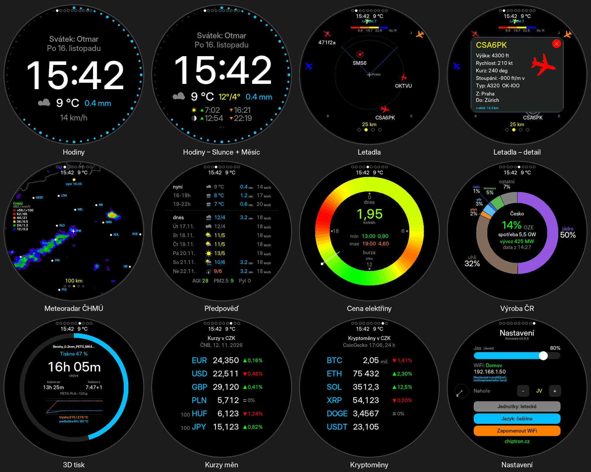

# MeteoPlaneRadar

**Hodiny, radar letadel, srážkový meteoradar, předpověď počasí a ceny
elektřiny na kulatém dotykovém displeji.** Běží na deskách Waveshare
ESP32-S3-Touch-LCD-2.1 a ESP32-S3-Touch-LCD-2.8C a nastavuje se z prohlížeče.

> Vyvíjí **[chiptron.cz](https://chiptron.cz)** a Claude AI.
> English version: **[README_EN.md](README_EN.md)**

> Líbí se ti tenhle projekt? Jdeš do něj? Je totiž kompletně zdarma. Podpořit mě ale můžeš, pokud chceš, tím, že mi koupíš kafe na **https://buymeacoffee.com/chiptroncz**

---



## Co to umí

| Obrazovka | Co ukazuje | Zdroj |
| --- | --- | --- |
| **Hodiny** | čas, datum, svátek (CZ/SK), počasí, vteřinový prstenec | Open-Meteo |
| **Letadla** | letadla v okolí s ikonou podle typu, detail letu včetně trasy | adsb.fi, adsb.lol, adsbdb |
| **Meteoradar** | animovaná srážková situace | ČHMÚ, ČHMÚ masked nebo RainViewer |
| **Předpověď** | nyní, +3 h, +6 h, dnes, zítra, pozítří a další dny, ovzduší a pyl | Open-Meteo |
| **Cena elektřiny** | spotová cena na 24hodinovém ciferníku, dnes i zítra | OTE přes spotovaelektrina.cz |
| **Výroba ČR** | z čeho se právě vyrábí, podíl OZE, spotřeba, vývoz | ENTSO-E přes energy-charts |
| **3D tisk** | průběh tisku na prstenci, zbývající čas, materiál, graf teplot | vaše tiskárna (PrusaLink, Moonraker) |
| **Kurzy měn** | až 6 měn v domácí měně se změnou proti předchozímu kurzu | ČNB (pro CZK), jinak ECB |
| **Kryptoměny** | až 6 mincí v domácí měně se změnou za 24 h | CoinGecko |
| **Nastavení** | jas, orientace mapy, jednotky, jazyk | — |

Všechny kromě Nastavení jde vypnout, Nastavení je dostupné vždy. Rozhraní je
česky, slovensky nebo anglicky. Písmo pro celý displej se volí na webu: vyhlazené Inter, Poppins,
Inter tenké (s diakritikou), nebo původní pixelové.

Obě energetické obrazovky jsou po aktualizaci vypnuté (zapnou se ve webovém
nastavení) a dokud jsou vypnuté, zařízení si o jejich data vůbec neřekne.
Zobrazená cena je **burzovní**, ne to, co platíte — vlastní přirážku a DPH
si lze doplnit na záložce Energie, viz [CHANGELOG](CHANGELOG.md).

## Hardware

**Waveshare ESP32-S3-Touch-LCD-2.1** nebo **ESP32-S3-Touch-LCD-2.8C** —
ESP32-S3R8 (8 MB PSRAM, 16 MB flash), kulatý displej 480×480 s řadičem S
T7701,
expandér TCA9554. Dotyk je CST820 (2.1), respektive GT911 (2.8C).
Stačí deska a USB-C kabel, nic se nepájí.

Obě desky jsou pinově totožné a **jedna binárka běží na obou** — firmware se při
startu zeptá dotykového řadiče, kdo je, a podle toho zvolí inicializaci panelu
i časování. Na kterou desku se rozhodl, ukazuje sériový výpis při startu a
stavová tabulka na webu. Kdyby to na vaší desce určilo špatně (typicky vadný
dotykový řadič), dá se to napevno vnutit přes `BOARD_FORCE` v `Config.h`.

---

## První zapnutí

1. Nahrajte firmware (viz níže) a zapněte desku.
2. Připojte se k otevřené síti **`MeteoPlaneRadar`** — na displeji je QR kód.
3. Otevřete `http://192.168.4.1/`, vyberte svou WiFi a uložte.

Přístupový bod zůstane aktivní, dokud síť nezadáte. Pokud už má zařízení nějakou
síť uloženou a jen se k ní po startu nepřipojilo (třeba po výpadku proudu ještě
nenaběhl router), každé dvě minuty se podívá, jestli je síť zpátky, a připojí se.
Když se na přístupový bod 30 minut nikdo nepřipojí, zařízení se restartuje.

Po připojení najdete nastavení na
**`http://meteoplaneradar.local/`** nebo na IP adrese, která je vypsaná na
obrazovce Nastavení.

## Nastavení v prohlížeči

Web běží trvale. Nastavíte v něm polohu (i vyhledáním města), které obrazovky
zobrazovat a jestli se mají střídat, zdroj meteoradaru, jazyk (čeština,
slovenčina, English — platí pro web i displej), denní a noční
jas, vzhled hodin, filtry letadel a upozornění na nouzové squawky. Je tam i
dálkové ovládání (přepínání obrazovek a rozsahu bez dotyku displeje), stavová
stránka, export a import nastavení a aktualizace firmwaru.

Od 0.9.8 se **všechno ukládá hned po změně**, obecné tlačítko Uložit už není.
Tři věci se projeví až po restartu zařízení: poloha, výběr obrazovek a zdroj
meteoradaru. Po jejich změně se dole objeví pruh *Změny se projeví po restartu*
s tlačítkem **Restartovat teď**; když ho nepoužijete, zařízení se restartuje
samo 2 minuty po poslední takové změně (do té doby běží s původním
nastavením a stihnete změnit víc věcí najednou). Vlastní tlačítka mají jen
WiFi, uložené sítě, údaje tiskárny, klíč CoinGecko a heslo správce.

Od 0.9.8 má **každá obrazovka svou záložku** (Hodiny, Letadla, Meteoradar,
Energie, Tiskárna, Kurzy & Krypto) a ta je vidět jen tehdy, když je obrazovka
zapnutá na záložce Obrazovky.
Výjimkou jsou funkce, které fungují i s vypnutou obrazovkou: letadlo poblíž,
meteoradar jen při bouřce a hlídání tiskárny drží svou záložku, dokud jsou
zapnuté. Záložka Displej (dříve Vzhled) má jen věci společné pro celý displej:
jas, noční režim, vypnutí v noci a písmo. Nastavení vypnutých funkcí se schovávají a nápovědy ukazují jednu větu,
zbytek je pod odkazem „Více“.

### Heslo

Heslo je **nepovinné a ve výchozím stavu žádné není** — aktualizace firmwaru,
import nastavení i tovární reset jsou hned po nahrání přístupné komukoli, kdo se
dostane na adresu zařízení. Nastavíte ho v záložce Systém v kartě **Změnit heslo
správce** vlastním tlačítkem: *Současné heslo* necháte poprvé prázdné, nové
zadáte dvakrát. Prázdné nové heslo ochranu zase vypne. Pole **Heslo správce**
nahoře slouží jen k odemčení importu a továrního resetu — s ukládáním nastavení
se heslo nikdy neposílá a nikdy se jím nemění. Uživatelské jméno na stránce
`/update` je `admin`.

Heslo se **ukládá v čitelné podobě**. Aktualizační stránka používá HTTP Basic a
knihovně se musí předat skutečné heslo, takže otisk tam použít nelze — hashovat
kopii v NVS, když vedle leží totéž otevřeně, by bylo jen divadlo. Chrání to před
domácností, ne před někým, kdo si přečte flash nebo odposlouchává síť.

**Zapomenuté heslo** jde zrušit jedině podržením tlačítka **BOOT při startu
(~3 s)**. To provede tovární reset, takže smaže i WiFi a všechna ostatní
nastavení.

## Ovládání

| Gesto | Akce |
| --- | --- |
| **Přejetí prstem** | změna rozsahu (letadla, meteoradar) |
| **Krátké klepnutí** | výběr letadla / přepnutí den–noc na hodinách |
| **Dlouhý stisk vlevo / vpravo** | předchozí / následující obrazovka |
| **BOOT při startu (~3 s)** | tovární reset |

Na obrazovce Nastavení se řádkem `Nahore` volí, **který světový směr je nahoře**
na radaru letadel — tedy směr, kterým se díváte z okna. Na webu je to totéž pole
*Okno míří na (nahoře na radaru)* a od 0.8.6 ho používá i výhled z okna.
Meteoradar se záměrně neotáčí.

**Noc a vypnutý displej (0.9.2).** Noční jas se zapíná ručně, podle slunce,
nebo podle času (záložka Displej). Displej se může ve zvoleném čase úplně
vypnout (*Vypnutí displeje v noci*, např. 23:00 – 6:00) — zařízení běží dál,
dotyk ho rozsvítí na 30 s a upozornění ho rozsvítí, pokud to povolíte.

**Rozložení hodin (0.9.3)** si vyberete na záložce Hodiny: základní, se Sluncem
a Měsícem, nebo s předpovědí na příští hodiny. Varianta se Sluncem a Měsícem
(od 0.9.7) má v řádku počasí dnešní max/min, pod ním východ a západ Slunce,
východ a západ Měsíce; ikona Měsíce v tom řádku ukazuje jeho aktuální fázi. Slunce i Měsíc platí pro polohu nastavenou na
webu (nebo zjištěnou podle IP): časy Slunce přicházejí z předpovědi
Open-Meteo, Měsíc se počítá přímo v zařízení. Když se řádek počasí nevejde,
vynechá se nejdřív vítr – srážky mají přednost.

**Svátek (0.9.2)** se ukazuje na hodinách nad datem: česky podle českého,
slovensky podle slovenského kalendáře, v angličtině ne.

**Trasu letadla** (odkud – kam) v detailu jde od 0.9.1 vypnout na záložce
Letadla. Dohledává se podle callsignu a občas nesedí; vypnutá se neukazuje ani
nedohledává.

**Tečky obrazovek** nahoře mohou od 0.9.1 po přepnutí samy zmizet (záložka
Obrazovky, *Tečky obrazovek nahoře*: vždy, nebo skrýt po 3, 5 či 10 s). Vrátí
je dotyk, dlouhý stisk nebo přepnutí z prohlížeče. Na obrazovce Nastavení
zůstávají, při upozornění se neukazují a v noci je nepřinese automatické
střídání. Výchozí je *vždy zobrazené*, jako dřív.

## Meteoradar: ČHMÚ, ČHMÚ masked nebo RainViewer

**ČHMÚ** je ostřejší, ale pokrývá jen ČR a okolí — s polohou v zahraničí zůstane
obrazovka prázdná. Ukazuje všechno, co radary vidí, plnou barvou.

**ČHMÚ masked** je tentýž snímek, ale ČHMÚ ho porovná s měřením ve výšce 2 km:
plnou barvou jsou jen místa, kde srážky opravdu dopadají na zem, zbytek
(srážky, které se cestou vypaří, kovadliny vzdálených bouřek) je bledší. Na
otázku „bude u nás pršet?“ odpovídá přesněji, pro sledování bouřek je lepší
plný ČHMÚ. **RainViewer** pokrývá Evropu i svět. Jeho dlaždice končí na
zoomu 7, takže bližší rozsahy se skládají ze zoomu 7 zvětšeného mocninou dvojky;
obraz je hrubší, ale víc detailu RainViewer nemá. Stahuje se postupně — nejdřív
nejnovější snímek, animace se dotáhne na pozadí. Legenda se přepíná spolu se
zdrojem, protože každý má vlastní paletu.

## Střídání obrazovek: bouřka a letadlo poblíž

Dvě volby dělají ze střídání něco chytřejšího (meteoradar v kartě Meteoradar
na záložce Obrazovky, letadlo na záložce Letadla):

- **Meteoradar jen při bouřce** — meteoradar se do střídání přidá, jen když je
  do zadané vzdálenosti (výchozí 50 km) odraz aspoň zadané síly (výchozí
  20 dBZ). Kontroluje se každých 5 minut nejnovější snímek ČHMÚ. Po dvou
  klidných snímcích meteoradar zase vypadne. Funguje i s jinak vypnutou
  obrazovkou Meteoradar.
- **Letadlo poblíž** — obrazovka Letadla se sama nestřídá,
  ale když se letadlo přiblíží na zadanou vzdálenost (výchozí 5 km), ukáže se
  na zadanou dobu (výchozí 15 s) i s otevřeným detailem a pak se pokračuje tam,
  kde se skončilo. Každé letadlo jednou za 15 minut. Volba *Co ukázat*
  (0.9.9) určuje průběh: **hned detail**, **nejdřív radar, pak detail**, nebo
  **jen radar**. Na radaru má letadlo tyrkysový kroužek a pod hodinami je jeho
  vzdálenost; při „nejdřív radar“ trvá radar čtvrtinu nastavené doby (nejméně
  5 s, nejvýš 15 s, nikdy víc než polovinu) a zbytek patří detailu. V detailu
  je od 0.9.9 i velká ikona letadla natočená podle kurzu.

**Výhled z okna** (záložka Letadla): šířka výhledu a dohled. Směr okna je směr
nahoře na radaru (viz Ovládání).
Letadlo ve výhledu má při upozornění přednost před bližším letadlem, které
z okna vidět není. Výseč se zakreslí do radaru letadel.

Všechny tyto limity se ukládají, přežijí restart a jsou v exportu i importu
nastavení.

## 3D tiskárna (0.9.0)

> **⚠ Zatím nevyzkoušeno se skutečnou tiskárnou.** Čtení odpovídá zveřejněné
> dokumentaci PrusaLinku a Moonrakeru. Pokud něco nesedí, pošlete prosím řádek
> Tiskárna ze stavové stránky webu.

Zařízení umí hlídat jednu 3D tiskárnu v místní síti: **Prusa** přes PrusaLink
(MK4, MK3.9, XL, MINI, CORE One, starší MK3S s RPi) nebo **Klipper** přes
Moonraker. Nastavuje se na záložce **Tiskárna**: typ, IP adresa (u Klipperu
případně s portem, výchozí je 7125), u Prusy jméno a heslo z menu tiskárny
(v nastavení sítě u PrusaLinku) nebo API klíč.

Obrazovka **3D tisk** je po aktualizaci vypnutá — zapíná se na záložce
Obrazovky. Do střídání obrazovek se zařadí jen během tisku. Ukazuje prstenec
uplynulého a zbývajícího času, stejné údaje číslem včetně času dokončení,
materiál ze souboru a graf teploty trysky a podložky za posledních 30 minut.

Upozornění na **konec tisku, chybu a pozastavení** chodí, i když je obrazovka
vypnutá. Displej se přepne na 3D tisk a drží upozornění, dokud se ho
nedotknete (nejdéle 30 minut, potom zůstane barevná tečka na hodinách).
V noci volíte noční jas s blikáním, plný jas, nebo klid bez blikání.

**Heslo, jméno a API klíč si zařízení pamatuje i po restartu** (ve flash, která
není šifrovaná). Na web se nikdy nevracejí. Do exportu a importu nastavení
jdou jen po zaškrtnutí *Heslo a API klíč i do exportu a importu nastavení*;
takový export pak chce heslo správce, pokud je nastavené.

Tiskárně se nikdy nic neposílá, zařízení jen čte. Nedostupná tiskárna
nezpomalí displej ani web: dotazy běží ve vlastní úloze s krátkými limity a
když tiskárna neodpovídá, ptá se zařízení jen jednou za minutu (po hodině
jednou za 5 minut).

## Kurzy měn (0.9.6)

Obrazovka **Kurzy měn** je po aktualizaci vypnutá — zapíná se na záložce
Obrazovky, nastavuje na záložce **Kurzy & Krypto**. Ukazuje až šest měn: kolik stojí
v domácí měně a šipkou změnu proti předchozímu kurzu.

Zdroj se řídí domácí měnou. Pro **CZK** jsou to kurzy devizového trhu
**ČNB**, pro ostatní (EUR, PLN, HUF, CHF, GBP, DKK, SEK, NOK, RON, USD)
referenční kurzy **ECB**; kurz mezi dvěma měnami jinými než euro se přepočítá
přes euro. Domácí měna „automaticky“ znamená: čeština → CZK, slovenština →
EUR, angličtina → měna země vybrané u výroby elektřiny (jinak EUR).

Kurz se vyhlašuje jednou za pracovní den (ČNB ~14:30, ECB ~16:00), proto se
zařízení ptá zřídka. Domácí měna i výběr měn jsou součástí exportu a importu
nastavení.

## Kryptoměny a výpadky zdrojů (0.9.7)

Obrazovka **Kryptoměny** (také vypnutá po aktualizaci) ukazuje až 6 mincí
v téže domácí měně a změnu za 24 hodin. Zdroj je CoinGecko bez klíče, dotaz
jednou za 10 minut; nepovinný Demo klíč se zadává na záložce Kurzy & Krypto a do
exportu se neukládá. Miliony se píšou jako „2,05 mil.“.

Když zdroj nefunguje, obrazovka bez dat napíše „Zdroj nedostupný“ a kdy
zkusí znovu; obrazovka s daty je ukazuje dál a označí je jako stará.

## Více WiFi sítí

Zařízení si pamatuje až **tři sítě**. Zapisují se v záložce Ovládání a jdou
zadat i když síť zrovna není v dosahu. Při startu se zkusí nejsilnější
dosažitelná, po výpadku spojení se po minutě projdou ostatní.

## Home Assistant

> **⚠ Tato funkce nebyla vyzkoušena se skutečným Home Assistantem.** Formát
> odpovídá dokumentaci integrace RESTful, ale ověřený zatím není. Pokud něco
> nesedí, dejte vědět.

Zařízení umí Home Assistantu nabídnout svá data. Funguje to opačně, než by se
čekalo: **Home Assistant si data sám stahuje** z adresy

```
http://meteoplaneradar.local/api/ha
```

(nebo z IP adresy zařízení). Nepotřebujete MQTT, broker ani doplněk — stačí
integrace **RESTful**, která je v Home Assistantu vestavěná. Postup:

1. Ve webovém nastavení zařízení na záložce **Home Assistant** zaškrtněte
   *Zpřístupnit data pro Home Assistant*.
2. Zkopírujte z té záložky připravený blok a vložte ho do
   `configuration.yaml` v Home Assistantu.
3. Restartujte Home Assistant. Objeví se senzory `MPR Teplota`, `MPR Bourka`,
   `MPR Nejblizsi letadlo` a další.

Odpověď vypadá takhle (zkráceno):

```json
{
  "temperature": 12.4, "wind_kmh": 14, "precip_mm": 0, "weather_code": 3,
  "today_min": 6.1, "today_max": 14.8, "sunrise": "06:41", "sunset": "16:52",
  "screen": "clock",
  "storm": { "active": false, "max_dbz": 16, "nearest_km": null, "frame": "10:05" },
  "aircraft": { "count": 3, "alert": false, "callsign": "CSA1234", "type": "A20N",
                "kind": "narrow-body", "distance_km": 4.2, "altitude_m": 3200,
                "in_window": true },
  "price_czk_kwh": 2.41, "renewable_pct": 18.5
}
```

Data jsou jen ke čtení a bez hesla — neříkají nic, co by nebylo vidět na
displeji. Dokud je funkce zapnutá, zařízení hlídá bouřku (jeden snímek ČHMÚ
za 5 minut) a letadla poblíž (malý dotaz jednou za 30 s), aby čísla byla živá.

Proč ne MQTT: potřebovalo by broker v síti, další knihovnu a nastavování
přihlašovacích údajů. REST stačí na čtení a jde nastavit jen vložením textu.
Kdyby se ukázalo, že je potřeba i ovládání z Home Assistantu, existující
adresy `/api/screen` a `/api/range` jde volat přes `rest_command`.

## Hodiny bez NTP

Čas se bere z hlavičky `Date` odpovědí, které zařízení stahuje tak jako tak.
Neprochází UDP portem 123, nedá se zvlášť zablokovat a nečeká se na něj při
startu. Časové pásmo je v `TZ_INFO` v `Config.h`.

---

## Nahrání firmwaru

**Přes USB** (první nahrání a záchrana): stáhněte `*.merged.bin` z Releases,
připojte desku do konektoru **USB** a nahrajte na
[esp32flasher.chiptron.cz](https://esp32flasher.chiptron.cz) v Chrome nebo Edge.

**Přes WiFi**: stáhněte `*.ino.bin` (bez `merged`) a nahrajte na
`http://meteoplaneradar.local/update`. Displej během zápisu zhasne — RGB panel
čte obraz z PSRAM a zápis do flash mu data odřezává. Po dokončení se rozsvítí.

Podrobnosti v [OTA_NAVOD.md](OTA_NAVOD.md).

---

## Pro vývojáře

Arduino IDE, **ESP32 core 3.x** (přeloženo s 3.3.10), knihovny: **GFX Library
for Arduino** (≥ 1.5.3, přeloženo s 1.6.9), **PNGdec** (≥ 1.1.4, přeloženo
s 1.1.7), **ArduinoJson v7**, QRCode (přibalen).
`WebServer`, `DNSServer`, `ESPmDNS`, `Update` a `Preferences` jsou v core.
WiFiManager se nepoužívá od 0.6.0, ElegantOTA od 0.6.2.

Nastavení IDE: ESP32S3 Dev Module, **PSRAM: OPI**, Flash 16 MB QIO,
**Partition Scheme: Custom** (`partitions.csv`, dvě aplikační oblasti pro OTA),
USB CDC On Boot: Enabled. Nebo `arduino-cli compile --profile default MeteoPlaneRadar`.

```
MeteoPlaneRadar.ino   správce obrazovek, dotyk, hlavní smyčka
Config.h              laditelné konstanty
Settings.*            nastavení v NVS + JSON pro web
Lang.*                české, anglické a slovenské řetězce
Layout.*              pásy obrazovky a hlídání kolizí
WebConfig.* WebPage.h webový server, API, portál, OTA
Net.*                 sdílené HTTPS stahování
Forecast.*            Open-Meteo: předpověď, slunce, ovzduší
Energy.*              spotová cena elektřiny a mix výroby ČR
RainViewer.*          dlaždicový radar
StormWatch.*          hlídání bouřky ze snímku ČHMÚ (0.8.0)
PrintWatch.* PrintParse.*  hlídání 3D tiskárny (0.9.0)
Fx.* FxParse.*        kurzy měn ČNB / ECB (0.9.6)
Crypto.*              kryptoměny z CoinGecko (0.9.7)
RateTable.*           tabulka kurzů a kryptoměn (0.9.7)
SrcHealth.h           stav zdroje dat, opakování a stáří dat (0.9.7)
Moon.*                východ, západ a fáze Měsíce, výpočet v zařízení (0.9.7)
NameDay.* NameDays.h  svátky na hodinách (0.9.2)
PlaneWatch.*          hlídání letadel poblíž a výhledu z okna (0.8.0)
PlaneIcon.*           ikony letadel podle typu (0.8.0)
AAFont.* ClockFonts.h vyhlazené písmo hodin (0.8.0)
Screen*.{h,cpp}       jednotlivé obrazovky
tools/make_fonts.py   generátor ClockFonts.h z TTF/OTF
tools/make_namedays.py  generátor NameDays.h (svátky CZ/SK, 0.9.2)
tools/textcheck/      kontrola kolizí textu na PC (0.8.6)
tools/printcheck/     testy čtení odpovědí tiskárny na PC (0.9.0)
```

**Proč se prvky nepřekrývají:** obrazovka si své pásy zabere dřív, než se kreslí
mapa. Cokoli umístěného podle dat (popisky měst, callsigny) si pak musí místo
vyžádat, a když je zabrané, nekreslí se vůbec. Konstanty `LY_*` v `Layout.h`
drží stejné prvky na stejných řádcích napříč obrazovkami. Od 0.8.6 si
data-umístěný prvek nemůže zabrat ani místo za okrajem kulatého displeje.

**Kontrola kolizí textu (0.8.6):** `tools/textcheck/build.sh` přeloží obrazovky
na PC a vykreslí každou ve všech třech jazycích a všech čtyřech písmech. Kde se
dva texty překrývají nebo text přesahuje okraj displeje, vypíše řádek
`TEXT: ...` a skončí nenulovým kódem. Stejnou kontrolu jde zapnout i přímo
v zařízení (`TEXT_CHECK 1` v `Config.h`), hlášení pak jdou na sériovou linku.

Sériový výpis 115200 Bd přes konektor **USB**. Totéž bez kabelu je na stavové
stránce webu.

---

## Zdroje dat

Jen pro osobní nekomerční použití — respektujte podmínky poskytovatelů.

**Letadla, registrace a typ:** [adsb.fi](https://adsb.fi) · **trasy:** [adsb.lol](https://adsb.lol), [adsbdb](https://www.adsbdb.com) ·
**srážky ČR:** [ČHMÚ](https://opendata.chmi.cz) ·
**srážky svět:** [RainViewer](https://www.rainviewer.com) ·
**počasí, ovzduší, geokódování:** [Open-Meteo](https://open-meteo.com) ·
**ceny elektřiny:** OTE-ČR přes [spotovaelektrina.cz](https://spotovaelektrina.cz) ·
**výroba elektřiny:** ENTSO-E přes [energy-charts](https://api.energy-charts.info) (Fraunhofer ISE) ·
**kurzy měn:** [ČNB](https://www.cnb.cz), [ECB](https://data.ecb.europa.eu) ·
**kryptoměny:** [Data provided by CoinGecko](https://www.coingecko.com/en/api) ·
**poloha podle IP:** [ip-api.com](http://ip-api.com) ·
**mapa:** hranice Natural Earth (public domain), města [GeoNames](https://www.geonames.org) (CC BY 4.0) ·
**čas:** hlavička `Date` (bez NTP) ·
**rozdělení ikon letadel:** [ADS-B Radar](https://adsb-radar.com/help/icons.html) ·
**svátky:** [namedays-cs](https://github.com/OzzyCzech/namedays-cs) (Roman Ožana, MIT),
[slovak-name-days](https://github.com/jozefgrencik/slovak-name-days) (Jozef Grenčík, MIT; oficiální kalendár MK SR)

## Přispěvatelé

- **[Pájeníčko.cz](https://pajenicko.cz)**
  - **Podpora desky Waveshare ESP32-S3-Touch-LCD-2.8C.** Deska se pozná při
    startu podle dotykového řadiče, takže jedna binárka běží na 2.1 i na 2.8C
    a nikdo nemusí vybírat, který soubor nahrát.
  - **Legendu na meteoradaru jde skrýt** — přepínač ve webovém nastavení.

## Z čeho projekt vychází

- [ok1cdj/MeteoPlaneRadar](https://github.com/ok1cdj/MeteoPlaneRadar) — fork Ondry OK1CDJ; odtud pochází nápad na RainViewer, obrazovku předpovědi, volitelné obrazovky a jejich střídání
- [CooLajz/waveshare-hodiny](https://github.com/CooLajz/waveshare-hodiny) — Home Assistant dashboard na stejné desce; inspirace pro hodiny, vteřinový prstenec, noční režim a webovou konfiguraci
- [MatixYo/ESP32-Plane-Radar](https://github.com/MatixYo/ESP32-Plane-Radar) — původní radar letadel a zdroj adsb.fi
- [Selbyl/ESP32-S30Touch-LCD-2.1_Plane-Radar](https://github.com/Selbyl/ESP32-S30Touch-LCD-2.1_Plane-Radar) — port na Waveshare 480×480
- [mylms/ESP-MeteoRadar](https://github.com/mylms/ESP-MeteoRadar) — srážkový meteoradar ČHMÚ

## Licence

**MIT** — viz [LICENSE.txt](LICENSE.txt). Vztahuje se na zdrojový kód i na
binárky z něj přeložené. Od 0.6.2 v projektu není žádná copyleftová závislost.

Písma hodin (**Inter**, **Poppins**) jsou pod licencí SIL Open Font License
1.1, která vložení do firmwaru dovoluje. Přiřazení typů letadel k ikonám
vychází ze schématu [adsb-radar.com](https://adsb-radar.com/help/icons.html).

**Na data se MIT nevztahuje.** **GeoNames**, **ČHMÚ**, **RainViewer** a
**Open-Meteo** vyžadují **uvedení zdroje**; Open-Meteo a adsb.fi mají bezplatné
API určené jen pro nekomerční použití. Podrobnosti jsou v `LICENSE.txt` —
**přečtěte si ho celý, než to nasadíte komerčně.**

Nad rámec licence budeme rádi, když na obrazovce nastavení ponecháte řádek
**chiptron.cz**.

Historie změn: [CHANGELOG.md](CHANGELOG.md). Verze: `MeteoPlaneRadar/Version.h`.
