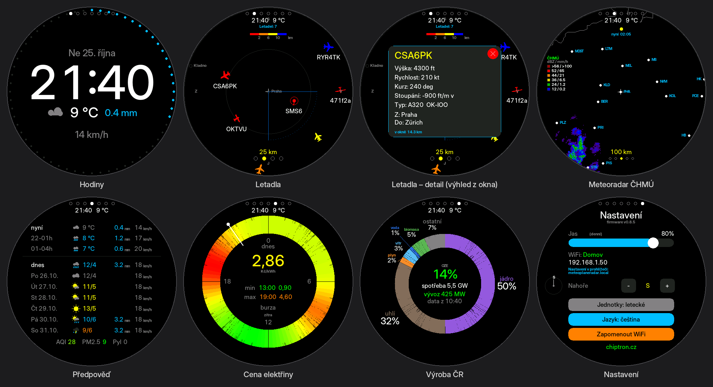
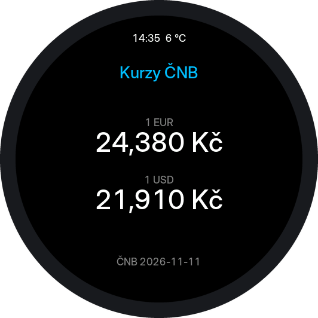
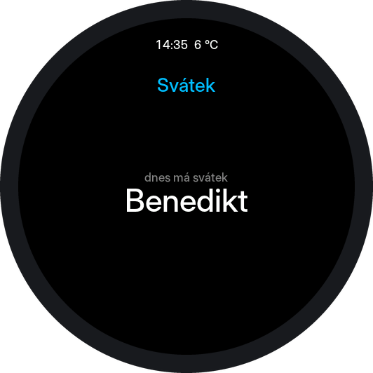
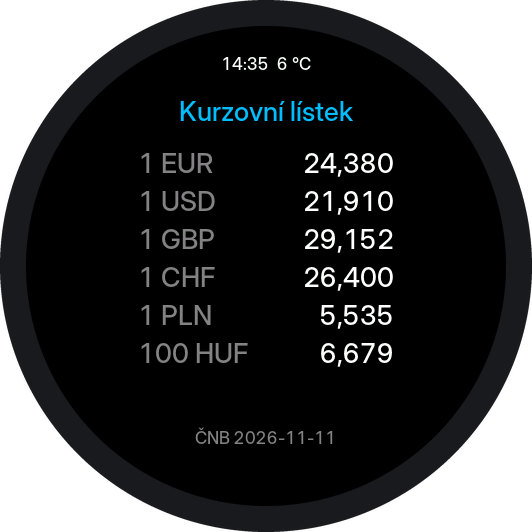
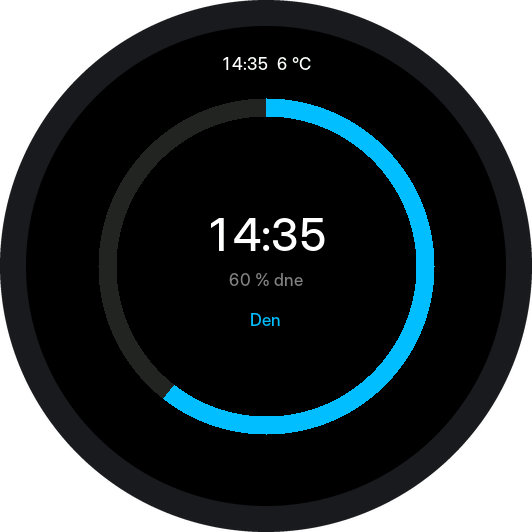
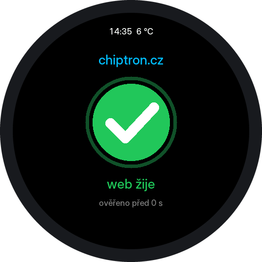

# MeteoPlaneRadar

**Hodiny, radar letadel, srážkový meteoradar, předpověď počasí a ceny
elektřiny na kulatém dotykovém displeji.** Běží na deskách Waveshare
ESP32-S3-Touch-LCD-2.1 a ESP32-S3-Touch-LCD-2.8C a nastavuje se z prohlížeče.

> Vyvíjí **[chiptron.cz](https://chiptron.cz)** a Claude AI.
> English version: **[README_EN.md](README_EN.md)**

> Líbí se ti tenhle projekt? Jdeš do něj? Je totiž kompletně zdarma. Podpořit mě ale můžeš, pokud chceš, tím, že mi koupíš kafe na **https://buymeacoffee.com/chiptroncz**

---



## Co to umí

| Obrazovka | Co ukazuje | Zdroj |
| --- | --- | --- |
| **Hodiny** | čas, datum, počasí, vteřinový prstenec | Open-Meteo |
| **Letadla** | letadla v okolí s ikonou podle typu, detail letu včetně trasy | adsb.fi, adsb.lol |
| **Meteoradar** | animovaná srážková situace | ČHMÚ, ČHMÚ masked nebo RainViewer |
| **Předpověď** | nyní, +3 h, +6 h, dnes, zítra, pozítří a další dny, ovzduší a pyl | Open-Meteo |
| **Cena elektřiny** | spotová cena na 24hodinovém ciferníku, dnes i zítra | OTE přes spotovaelektrina.cz |
| **Výroba ČR** | z čeho se právě vyrábí, podíl OZE, spotřeba, vývoz | ENTSO-E přes energy-charts |
| **Karty** | vlastní obrazovky: hodnoty z libovolného JSON rozhraní (např. kurzy ČNB) nebo karta s vlastním programem | podle karty, viz [cards](cards/README.md) |
| **Nastavení** | jas, orientace mapy, jednotky, jazyk | — |

Prvních sedm jde vypnout, Nastavení je dostupné vždy. Rozhraní je česky nebo
anglicky. Písmo pro celý displej se volí na webu: vyhlazené Inter, Poppins,
Inter tenké (s diakritikou), nebo původní pixelové.

Obě energetické obrazovky jsou po aktualizaci vypnuté (zapnou se ve webovém
nastavení) a dokud jsou vypnuté, zařízení si o jejich data vůbec neřekne.
Zobrazená cena je **burzovní**, ne to, co platíte — vlastní přirážku a DPH
si lze doplnit na záložce Energie, viz [CHANGELOG](CHANGELOG.md).

## Hardware

**Waveshare ESP32-S3-Touch-LCD-2.1** nebo **ESP32-S3-Touch-LCD-2.8C** —
ESP32-S3R8 (8 MB PSRAM, 16 MB flash), kulatý displej 480×480 s řadičem S
T7701,
expandér TCA9554. Dotyk je CST820 (2.1), respektive GT911 (2.8C).
Stačí deska a USB-C kabel, nic se nepájí.

Obě desky jsou pinově totožné a **jedna binárka běží na obou** — firmware se při
startu zeptá dotykového řadiče, kdo je, a podle toho zvolí inicializaci panelu
i časování. Na kterou desku se rozhodl, ukazuje sériový výpis při startu a
stavová tabulka na webu. Kdyby to na vaší desce určilo špatně (typicky vadný
dotykový řadič), dá se to napevno vnutit přes `BOARD_FORCE` v `Config.h`.

---

## První zapnutí

1. Nahrajte firmware (viz níže) a zapněte desku.
2. Připojte se k otevřené síti **`MeteoPlaneRadar`** — na displeji je QR kód.
3. Otevřete `http://192.168.4.1/`, vyberte svou WiFi a uložte.

Přístupový bod zůstane aktivní, dokud síť nezadáte. Potom najdete nastavení na
**`http://meteoplaneradar.local/`** nebo na IP adrese, která je vypsaná na
obrazovce Nastavení.

## Nastavení v prohlížeči

Web běží trvale. Nastavíte v něm polohu (i vyhledáním města), které obrazovky
zobrazovat a jestli se mají střídat, zdroj meteoradaru, jazyk, denní a noční
jas, vzhled hodin, filtry letadel a upozornění na nouzové squawky. Je tam i
dálkové ovládání (přepínání obrazovek a rozsahu bez dotyku displeje), stavová
stránka, export a import nastavení a aktualizace firmwaru.

Většina položek se **ukládá hned po změně**. Tlačítko Uložit zůstává jen pro
polohu, výběr obrazovek a zdroj meteoradaru — ty vyžadují restart zařízení.

### Heslo

Heslo je **nepovinné a ve výchozím stavu žádné není** — aktualizace firmwaru,
import nastavení i tovární reset jsou hned po nahrání přístupné komukoli, kdo se
dostane na adresu zařízení. Nastavíte ho v záložce Systém: pole *Současné heslo*
necháte poprvé prázdné a vyplníte jen *Nové heslo*. Jedna mezera v Novém hesle
ochranu zase zruší. Uživatelské jméno na stránce `/update` je `admin`.

Heslo se **ukládá v čitelné podobě**. Aktualizační stránka používá HTTP Basic a
knihovně se musí předat skutečné heslo, takže otisk tam použít nelze — hashovat
kopii v NVS, když vedle leží totéž otevřeně, by bylo jen divadlo. Chrání to před
domácností, ne před někým, kdo si přečte flash nebo odposlouchává síť.

**Zapomenuté heslo** jde zrušit jedině podržením tlačítka **BOOT při startu
(~3 s)**. To provede tovární reset, takže smaže i WiFi a všechna ostatní
nastavení.

## Ovládání

| Gesto | Akce |
| --- | --- |
| **Přejetí prstem** | změna rozsahu (letadla, meteoradar) |
| **Krátké klepnutí** | výběr letadla / přepnutí den–noc na hodinách |
| **Dlouhý stisk vlevo / vpravo** | předchozí / následující obrazovka |
| **BOOT při startu (~3 s)** | tovární reset |

Na obrazovce Nastavení se řádkem `Nahore` volí, **který světový směr je nahoře**
na radaru letadel — tedy směr, kterým se díváte z okna. Meteoradar se záměrně
neotáčí.

## Meteoradar: ČHMÚ, ČHMÚ masked nebo RainViewer

**ČHMÚ** je ostřejší, ale pokrývá jen ČR a okolí — s polohou v zahraničí zůstane
obrazovka prázdná. Ukazuje všechno, co radary vidí, plnou barvou.

**ČHMÚ masked** je tentýž snímek, ale ČHMÚ ho porovná s měřením ve výšce 2 km:
plnou barvou jsou jen místa, kde srážky opravdu dopadají na zem, zbytek
(srážky, které se cestou vypaří, kovadliny vzdálených bouřek) je bledší. Na
otázku „bude u nás pršet?“ odpovídá přesněji, pro sledování bouřek je lepší
plný ČHMÚ. **RainViewer** pokrývá Evropu i svět. Jeho dlaždice končí na
zoomu 7, takže bližší rozsahy se skládají ze zoomu 7 zvětšeného mocninou dvojky;
obraz je hrubší, ale víc detailu RainViewer nemá. Stahuje se postupně — nejdřív
nejnovější snímek, animace se dotáhne na pozadí. Legenda se přepíná spolu se
zdrojem, protože každý má vlastní paletu.

## Střídání obrazovek: bouřka a letadlo poblíž

Dvě volby na záložce Obrazovky dělají ze střídání něco chytřejšího:

- **Meteoradar jen při bouřce** — meteoradar se do střídání přidá, jen když je
  do zadané vzdálenosti (výchozí 50 km) odraz aspoň zadané síly (výchozí
  20 dBZ). Kontroluje se každých 5 minut nejnovější snímek ČHMÚ. Po dvou
  klidných snímcích meteoradar zase vypadne. Funguje i s jinak vypnutou
  obrazovkou Meteoradar.
- **Letadla jen když je letadlo poblíž** — obrazovka Letadla se sama nestřídá,
  ale když se letadlo přiblíží na zadanou vzdálenost (výchozí 5 km), ukáže se
  na zadanou dobu (výchozí 15 s) i s otevřeným detailem a pak se pokračuje tam,
  kde se skončilo. Každé letadlo jednou za 15 minut.

**Výhled z okna** (záložka Letadla): směr okna, šířka výhledu a dohled.
Letadlo ve výhledu má při upozornění přednost před bližším letadlem, které
z okna vidět není. Výseč se zakreslí do radaru letadel.

Všechny tyto limity se ukládají, přežijí restart a jsou v exportu i importu
nastavení.

## Více WiFi sítí

Zařízení si pamatuje až **tři sítě**. Zapisují se v záložce Ovládání a jdou
zadat i když síť zrovna není v dosahu. Při startu se zkusí nejsilnější
dosažitelná, po výpadku spojení se po minutě projdou ostatní.

## Home Assistant

> **⚠ Tato funkce nebyla vyzkoušena se skutečným Home Assistantem.** Formát
> odpovídá dokumentaci integrace RESTful, ale ověřený zatím není. Pokud něco
> nesedí, dejte vědět.

Zařízení umí Home Assistantu nabídnout svá data. Funguje to opačně, než by se
čekalo: **Home Assistant si data sám stahuje** z adresy

```
http://meteoplaneradar.local/api/ha
```

(nebo z IP adresy zařízení). Nepotřebujete MQTT, broker ani doplněk — stačí
integrace **RESTful**, která je v Home Assistantu vestavěná. Postup:

1. Ve webovém nastavení zařízení na záložce **Home Assistant** zaškrtněte
   *Zpřístupnit data pro Home Assistant*.
2. Zkopírujte z té záložky připravený blok a vložte ho do
   `configuration.yaml` v Home Assistantu.
3. Restartujte Home Assistant. Objeví se senzory `MPR Teplota`, `MPR Bourka`,
   `MPR Nejblizsi letadlo` a další.

Odpověď vypadá takhle (zkráceno):

```json
{
  "temperature": 12.4, "wind_kmh": 14, "precip_mm": 0, "weather_code": 3,
  "today_min": 6.1, "today_max": 14.8, "sunrise": "06:41", "sunset": "16:52",
  "screen": "clock",
  "storm": { "active": false, "max_dbz": 16, "nearest_km": null, "frame": "10:05" },
  "aircraft": { "count": 3, "alert": false, "callsign": "CSA1234", "type": "A20N",
                "kind": "narrow-body", "distance_km": 4.2, "altitude_m": 3200,
                "in_window": true },
  "price_czk_kwh": 2.41, "renewable_pct": 18.5
}
```

Data jsou jen ke čtení a bez hesla — neříkají nic, co by nebylo vidět na
displeji. Dokud je funkce zapnutá, zařízení hlídá bouřku (jeden snímek ČHMÚ
za 5 minut) a letadla poblíž (malý dotaz jednou za 30 s), aby čísla byla živá.

Proč ne MQTT: potřebovalo by broker v síti, další knihovnu a nastavování
přihlašovacích údajů. REST stačí na čtení a jde nastavit jen vložením textu.
Kdyby se ukázalo, že je potřeba i ovládání z Home Assistantu, existující
adresy `/api/screen` a `/api/range` jde volat přes `rest_command`.

## Karty

Karty jsou vlastní obrazovky, které si doplníte sami. Každá karta je samostatná
obrazovka: střídá se s ostatními ve stejném intervalu, takže čtyři vestavěné
obrazovky a dvě karty dávají šest obrazovek. Karet může být nejvýš 8. Řada
teček nahoře, která má jednu tečku za každou obrazovku i kartu, je proto ve
výchozím stavu skrytá; zapnout jde na webu zařízení. Patří k nim tři části:

| | |
| --- | --- |
| **[JSON karty](#json-karty)** | karta bez programu: malý soubor říká, odkud stáhnout odpověď a které hodnoty z ní ukázat; rozvržení dělá firmware |
| **[Karty se skriptem](#karty-se-skriptem-program-v-kartě)** | karta s **vlastním programem** v jazyce Berry, který si celý displej kreslí sám |
| **[Obchod s kartami](#obchod-s-kartami)** | zařízení si karty z tohoto repozitáře přidá samo a předtím ověří jejich podpis |

<p align="center">
  
  
</p>
<p align="center">
  
  
  
</p>
<p align="center"><sub>Náhledy ukázkových karet: nahoře dvě karty JSON, dole tři karty se skriptem. Obrazovky vykreslil kód firmwaru spuštěný na PC se skutečnými odpověďmi zdrojů (kurzy z 11. 11. 2026, svátek z 12. 11. 2026); nejsou to fotky z desky.</sub></p>

### JSON karty

Karta JSON ukazuje hodnoty, které si doplníte sami: kurzy měn, teplotu
z domácí automatizace, cokoli, co má JSON rozhraní dostupné bez přihlášení.
Je to malý soubor, který říká, odkud se má stáhnout odpověď, které hodnoty
z ní vybrat a jak je pojmenovat. Tenhle druh karty je popis, ne program:
rozvržení na kulatém displeji dělá firmware.

Ukázková karta s kurzy ČNB ([cards/kurzy-cnb.json](cards/kurzy-cnb.json)):

```json
{
  "v": 1,
  "id": "kurzy-cnb",
  "title": "Kurzy ČNB",
  "url": "https://api.cnb.cz/cnbapi/exrates/daily?lang=EN",
  "refresh_min": 60,
  "rows": [
    { "label": "1 EUR", "path": "rates[currencyCode=EUR].rate", "decimals": 3, "unit": "Kč" },
    { "label": "1 USD", "path": "rates[currencyCode=USD].rate", "decimals": 3, "unit": "Kč" }
  ],
  "note": { "label": "ČNB", "path": "rates[0].validFor" }
}
```

Druhá ukázka, [cards/svatek.json](cards/svatek.json), ukazuje textovou hodnotu:
kdo má dnes svátek, podle nameday.abalin.net.

| | |
| --- | --- |
| **Hodnoty** | na kartě 1 až 4 hodnoty a volitelný malý řádek dole |
| **Cesta k hodnotě** | `data.amount`, `list[0].price` nebo `rates[currencyCode=EUR].rate` — prvek pole podle obsahu, ne podle pořadí |
| **Formát hodnoty** | popisek, jednotka, počet desetinných míst, násobitel; v češtině s desetinnou čárkou |

### Karty se skriptem: program v kartě

Karta JSON umí jen několik hodnot v pevném rozvržení. Karta, která má navíc
položku `script`, v sobě nese **program** v jazyce
[Berry](https://berry-lang.github.io) a celý displej si kreslí sama: tabulky,
prstence, vlastní rozvržení. Adresu uvedenou v kartě dál stahuje zařízení;
program rozhodne, co z odpovědi nakreslí.

Program ukázkové karty Den ([cards/src/den.be](cards/src/den.be), zkráceno):
prstenec ukazuje, kolik dne už uběhlo.

```berry
def draw()
  var s = cfg.hms()   # sekundy od půlnoci
  g.ring(240, 240, 150, 168, 0, 360, g.DKGRAY)
  if s == nil
    g.label('čekám na čas', 232, 2, g.YELLOW)
    return
  end
  g.ring(240, 240, 150, 168, 0, s * 360 / 86400, g.CYAN)
  g.label(format('%02d:%02d', s / 3600, (s % 3600) / 60), 190, 5, g.WHITE)
end
```

| | |
| --- | --- |
| **Ukázky** | [kurzy-listek.json](cards/kurzy-listek.json) — kurzovní lístek ČNB, šest měn pod sebou se zarovnanými čísly; [den.json](cards/den.json) — kolik dne už uběhlo, nepotřebuje internet; [web-chiptron.json](cards/web-chiptron.json) — žije web chiptron.cz? zelená fajfka, nebo po třech nezdarech za sebou červený křížek ([popis](cards/README.md#ukázka-hlídání-webu)). Programy jsou ve složce [cards/src](cards/src) |
| **Zapnutí** | skripty jsou ve výchozím stavu **vypnuté**. Zapínají se na webu zařízení, záložka Obrazovky, volba **Povolit skripty v kartách**. Dokud jsou vypnuté, karta se skriptem ukáže jen nadpis a hlášení, že skript neběží |
| **Co program smí** | kreslit (`g`), číst odpověď z adresy své karty (`net`), číst parametry karty a čas (`cfg`). Nemá přístup k souborům, k nastavení ani k síti: sám nic nestáhne ani neodešle |
| **Pojistky** | jedno vykreslení smí trvat 500 ms a zabrat 96 kB paměti; po třech selháních za sebou se skript té karty vypne; restartuje-li se zařízení uprostřed skriptu, vypne se skript při dalším startu (bezpečný režim) |
| **Velikost** | program nejvýš 6000 bajtů, celá karta nejvýš 8192 bajtů |
| **Jak ji napsat** | program `.be` a popis `.json` složí do jedné karty `tools/make_script_card.py`; kartu jde vyzkoušet na počítači bez desky simulátorem v [tools/sim](tools/sim) |

Přesto je to program. Karty se skriptem berte jen ze zdroje, kterému byste
svěřili i aktualizaci firmwaru. Rozhraní pro skripty a postup, jak kartu
napsat: [cards/README.md](cards/README.md#karty-se-skriptem).

### Obchod s kartami

Karty z tohoto repozitáře jde přidat bez stahování souboru: na webu zařízení,
záložka **Obchod**, tlačítko **Načíst nabídku** a u vybrané karty **Přidat**.
Nabídka je seznam [cards/index.json](cards/index.json). Zařízení ověří podpis
seznamu (ECDSA P-256) proti klíči ve firmwaru a každou kartu porovná
s otiskem SHA-256 ze seznamu; změněný, nepodepsaný nebo starší seznam odmítne.
Podpis říká jen to, že seznam zveřejnil držitel klíče, ne že karty někdo
prověřil. Podrobnosti a postup pro vlastní obchod:
[cards/README.md](cards/README.md#obchod-s-kartami).

### Společné pro všechny karty

| | |
| --- | --- |
| **Správa** | nahrání a odebrání na webu zařízení, záložka Obrazovky, nebo přidání z obchodu; s heslem správce, je-li nastavené |
| **Uložení** | LittleFS v oddílu `spiffs`, který projekt dosud nepoužíval; karty přežijí restart i aktualizaci firmwaru |
| **Stahování** | každých 5 až 1440 minut (výchozí 60); po chybě zůstanou poslední hodnoty s poznámkou a zkouší se znovu za 2 minuty |
| **Výchozí stav** | obrazovka Karty je vypnutá a vypnutá nic nestahuje; skripty se povolují zvlášť |
| **Tečky obrazovek** | řada teček nahoře je ve výchozím stavu skrytá; zapíná se na záložce Obrazovky volbou **Zobrazovat tečky obrazovek nahoře** a změna se projeví hned |
| **API** | `/api/cards` (GET, POST), `/api/cards/delete` (POST), `/api/store` (GET), `/api/store/install` (POST), `/api/scripts` (POST); `cards` přibylo v `/api/config`, `/api/status` a `/api/ha` |
| **Cena** | karty zvětšují binárku o 56 kB, obchod o dalších 12 kB, skripty o dalších asi 100 kB; žádná knihovna k instalaci nepřibyla (interpret Berry je přibalený) |
| **Omezení** | karta zatím neumí poslat HTTP hlavičky (např. `Authorization`), takže funguje jen to, co jde přečíst bez přihlášení |

Úplný popis formátu je v [cards/README.md](cards/README.md).

## Hodiny bez NTP

Čas se bere z hlavičky `Date` odpovědí, které zařízení stahuje tak jako tak.
Neprochází UDP portem 123, nedá se zvlášť zablokovat a nečeká se na něj při
startu. Časové pásmo je v `TZ_INFO` v `Config.h`.

---

## Nahrání firmwaru

**Přes USB** (první nahrání a záchrana): stáhněte `*.merged.bin` z Releases,
připojte desku do konektoru **USB** a nahrajte na
[esp32flasher.chiptron.cz](https://esp32flasher.chiptron.cz) v Chrome nebo Edge.

**Přes WiFi**: stáhněte `*.ino.bin` (bez `merged`) a nahrajte na
`http://meteoplaneradar.local/update`. Displej během zápisu zhasne — RGB panel
čte obraz z PSRAM a zápis do flash mu data odřezává. Po dokončení se rozsvítí.

Podrobnosti v [OTA_NAVOD.md](OTA_NAVOD.md).

---

## Pro vývojáře

Arduino IDE, **ESP32 core 3.x** (přeloženo s 3.3.10), knihovny: **GFX Library
for Arduino** (≥ 1.5.3, přeloženo s 1.6.9), **PNGdec** (≥ 1.1.4, přeloženo
s 1.1.7), **ArduinoJson v7**, QRCode (přibalen).
`WebServer`, `DNSServer`, `ESPmDNS`, `Update` a `Preferences` jsou v core.
WiFiManager se nepoužívá od 0.6.0, ElegantOTA od 0.6.2.

Nastavení IDE: ESP32S3 Dev Module, **PSRAM: OPI**, Flash 16 MB QIO,
**Partition Scheme: Custom** (`partitions.csv`, dvě aplikační oblasti pro OTA),
USB CDC On Boot: Enabled. Nebo `arduino-cli compile --profile default MeteoPlaneRadar`.

```
MeteoPlaneRadar.ino   správce obrazovek, dotyk, hlavní smyčka
Config.h              laditelné konstanty
Settings.*            nastavení v NVS + JSON pro web
Lang.*                české a anglické řetězce
Layout.*              pásy obrazovky a hlídání kolizí
WebConfig.* WebPage.h webový server, API, portál, OTA
Net.*                 sdílené HTTPS stahování
Forecast.*            Open-Meteo: předpověď, slunce, ovzduší
Energy.*              spotová cena elektřiny a mix výroby ČR
RainViewer.*          dlaždicový radar
StormWatch.*          hlídání bouřky ze snímku ČHMÚ (0.8.0)
PlaneWatch.*          hlídání letadel poblíž a výhledu z okna (0.8.0)
PlaneIcon.*           ikony letadel podle typu (0.8.0)
AAFont.* ClockFonts.h vyhlazené písmo hodin (0.8.0)
Screen*.{h,cpp}       jednotlivé obrazovky
tools/make_fonts.py   generátor ClockFonts.h z TTF/OTF
```

**Proč se prvky nepřekrývají:** obrazovka si své pásy zabere dřív, než se kreslí
mapa. Cokoli umístěného podle dat (popisky měst, callsigny) si pak musí místo
vyžádat, a když je zabrané, nekreslí se vůbec. Konstanty `LY_*` v `Layout.h`
drží stejné prvky na stejných řádcích napříč obrazovkami.

Sériový výpis 115200 Bd přes konektor **USB**. Totéž bez kabelu je na stavové
stránce webu.

---

## Zdroje dat

Jen pro osobní nekomerční použití — respektujte podmínky poskytovatelů.

**Letadla, registrace a typ:** [adsb.fi](https://adsb.fi) · **trasy:** [adsb.lol](https://adsb.lol) ·
**srážky ČR:** [ČHMÚ](https://opendata.chmi.cz) ·
**srážky svět:** [RainViewer](https://www.rainviewer.com) ·
**počasí, ovzduší, geokódování:** [Open-Meteo](https://open-meteo.com) ·
**ceny elektřiny:** OTE-ČR přes [spotovaelektrina.cz](https://spotovaelektrina.cz) ·
**výroba elektřiny:** ENTSO-E přes [energy-charts](https://api.energy-charts.info) (Fraunhofer ISE) ·
**poloha podle IP:** [ip-api.com](http://ip-api.com) ·
**mapa:** hranice Natural Earth (public domain), města [GeoNames](https://www.geonames.org) (CC BY 4.0) ·
**čas:** hlavička `Date` (bez NTP) ·
**rozdělení ikon letadel:** [ADS-B Radar](https://adsb-radar.com/help/icons.html)

## Přispěvatelé

- **[Pájeníčko.cz](https://pajenicko.cz)**
  - **Podpora desky Waveshare ESP32-S3-Touch-LCD-2.8C.** Deska se pozná při
    startu podle dotykového řadiče, takže jedna binárka běží na 2.1 i na 2.8C
    a nikdo nemusí vybírat, který soubor nahrát.
  - **Legendu na meteoradaru jde skrýt** — přepínač ve webovém nastavení.

## Z čeho projekt vychází

- [ok1cdj/MeteoPlaneRadar](https://github.com/ok1cdj/MeteoPlaneRadar) — fork Ondry OK1CDJ; odtud pochází nápad na RainViewer, obrazovku předpovědi, volitelné obrazovky a jejich střídání
- [CooLajz/waveshare-hodiny](https://github.com/CooLajz/waveshare-hodiny) — Home Assistant dashboard na stejné desce; inspirace pro hodiny, vteřinový prstenec, noční režim a webovou konfiguraci
- [MatixYo/ESP32-Plane-Radar](https://github.com/MatixYo/ESP32-Plane-Radar) — původní radar letadel a zdroj adsb.fi
- [Selbyl/ESP32-S30Touch-LCD-2.1_Plane-Radar](https://github.com/Selbyl/ESP32-S30Touch-LCD-2.1_Plane-Radar) — port na Waveshare 480×480
- [mylms/ESP-MeteoRadar](https://github.com/mylms/ESP-MeteoRadar) — srážkový meteoradar ČHMÚ

## Licence

**MIT** — viz [LICENSE.txt](LICENSE.txt). Vztahuje se na zdrojový kód i na
binárky z něj přeložené. Od 0.6.2 v projektu není žádná copyleftová závislost.

Písma hodin (**Inter**, **Poppins**) jsou pod licencí SIL Open Font License
1.1, která vložení do firmwaru dovoluje. Přiřazení typů letadel k ikonám
vychází ze schématu [adsb-radar.com](https://adsb-radar.com/help/icons.html).

**Na data se MIT nevztahuje.** **GeoNames**, **ČHMÚ**, **RainViewer** a
**Open-Meteo** vyžadují **uvedení zdroje**; Open-Meteo a adsb.fi mají bezplatné
API určené jen pro nekomerční použití. Podrobnosti jsou v `LICENSE.txt` —
**přečtěte si ho celý, než to nasadíte komerčně.**

Nad rámec licence budeme rádi, když na obrazovce nastavení ponecháte řádek
**chiptron.cz**.

Historie změn: [CHANGELOG.md](CHANGELOG.md). Verze: `MeteoPlaneRadar/Version.h`.
