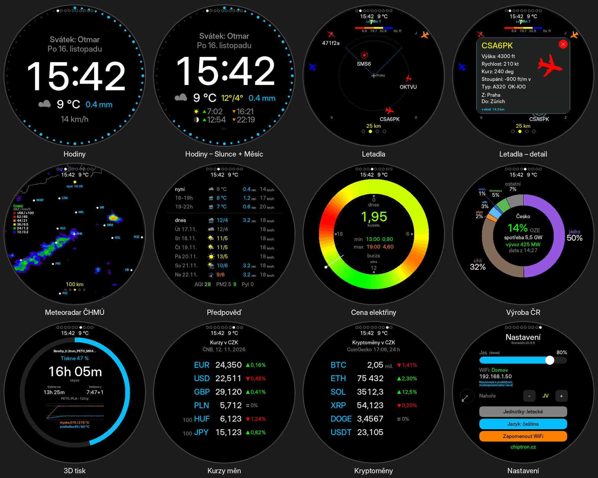

# MeteoPlaneRadar

**A clock, live aircraft radar, precipitation radar, weather forecast and
electricity prices on a round touchscreen.** Runs on a single Waveshare
ESP32-S3-Touch-LCD-2.1 or ESP32-S3-Touch-LCD-2.8C board and is configured from
a browser.

> Built by **[chiptron.cz](https://chiptron.cz)** with Claude AI.
> Czech version of this document: [README.md](README.md)

> Do you like this project? It is free and open-source but you may support me by **https://buymeacoffee.com/chiptroncz**




---

## Switch it to English

The device ships in Czech. There are two ways to change that, and both stick
across restarts.

### On the device

1. **Long-press the right half of the screen** until you reach **Nastaveni**
   (Settings) — it is the last screen in the cycle.
2. Near the bottom there are three wide buttons. Press the **middle** one,
   labelled **`Jazyk: cestina`**.
3. It immediately becomes **`Language: English`** and the whole interface
   follows. Pressing it again cycles on to Slovak (0.8.6) and back to Czech.

### In the browser

1. Open `http://meteoplaneradar.local/` (the address is also printed on the
   Settings screen).
2. Top right there is a language selector — choose **English**.

The page and the device both switch immediately; there is nothing to save.

The same selector appears in the setup portal during first-time WiFi
configuration, so you can switch before anything else.

> The built-in display font is 7-bit ASCII. Czech is therefore drawn without
> diacritics; English renders exactly as written.

---

## What it is

A standalone WiFi device with a round 480×480 touchscreen. Put it on a shelf
next to your monitor and a glance tells you what is flying overhead and whether
it is about to rain.

It is not a phone and does not try to be one.

## What it does

| Screen | Shows | Source |
| --- | --- | --- |
| **Clock** | time, date, name day (CZ/SK), current weather, seconds ring | Open-Meteo |
| **Aircraft** | aircraft around you, tap for details and route | adsb.fi, adsb.lol, adsbdb |
| **Weather radar** | animated precipitation | CHMI, CHMI masked or RainViewer |
| **Forecast** | now, two 3-hour windows, today and six more days, air quality and pollen | Open-Meteo |
| **Electricity price** | spot price on a quarter-hour dial, today and tomorrow | OTE via spotovaelektrina.cz |
| **Generation** | what the grid is running on, renewable share, load, export | Energy-Charts (Fraunhofer ISE) |
| **3D print** | print progress on a ring, time left, material, temperature graph | your printer (PrusaLink, Moonraker) |
| **Exchange rates** | up to 6 currencies in your home currency, change against the previous fixing | CNB (for CZK), ECB otherwise |
| **Crypto** | up to 6 coins in your home currency, change over 24 h | CoinGecko |
| **Settings** | brightness, map orientation, units, language | — |

Any screen except Settings can be switched off in the browser; Settings is
always reachable.

Both energy screens are **off after an update** — turn them on in the browser.
While a screen is off the device never asks for its data at all.

### Clock

Date, large time, current weather with temperature and rain, wind speed below.
A **seconds ring** runs around the rim — off, dots, a continuous line, or a
comet with a fading tail. Clock and seconds colours are configurable.

**Typeface** (0.8.0): the time, date, temperature and wind are drawn from real
font outlines with 16 levels of anti-aliasing — **Inter** (default),
**Poppins**, **Inter thin**, or the original pixel font. The digits are
tabular, so the time does not shift sideways as the minutes change, and the
Czech date keeps its accents.

No Home Assistant and no sensor: the weather comes from the same request the
forecast screen makes anyway.

There is **no NTP client**. The time is taken from the `Date` header of the
HTTP responses the device makes regardless.

The **time zone** rides along with the forecast: Open-Meteo returns the offset
for your own coordinates, so it costs no extra request and nothing to set. Until
the first fetch the rule compiled into `TZ_INFO` in `Config.h` applies, which is
Central European Time. If the offset from the network matches what is already in
force, the compiled-in rule stays — so a Czech device keeps real daylight-saving
dates rather than freezing at one offset. Otherwise the device switches to the
fixed offset the server reported. The current value is on the web status page.

### Aircraft

Aircraft icons are colour-coded by flight level. Since 0.8.0 the three
boundaries and the four colours can be changed on the Aircraft tab; the
defaults are:

| Altitude | Colour | Typically |
| --- | --- | --- |
| Below 2 km | Red | Approach and departure, helicopters, light aircraft |
| 2 to 6 km | Orange | Climb, descent, regional traffic |
| 6 to 10 km | Yellow | Lower cruise levels |
| 10 km and up | Blue | Long-haul cruise |

An aircraft not reporting its altitude is drawn grey, not red. The boundaries
and colours can be changed in the browser. The legend under the aircraft count,
the boundaries and the altitude filter follow the units option (0.8.7): km and
m with metric units, thousands of feet ("kft") and ft with aviation units.

The **icon follows the airframe** (0.8.0), after the scheme of
[adsb-radar.com](https://adsb-radar.com/help/icons.html): helicopters have a
rotor disc, gliders long thin wings, an A380 is visibly bigger than a Cessna.
The kind comes from the ICAO type code adsb.fi sends (A20N, B738, EC35...), or
from the ADS-B emitter category when the type is unknown; anything else keeps
the original arrow.

**Aircraft nearby** (0.8.0, Aircraft tab since 0.8.6): the Aircraft screen leaves the
automatic cycling and instead jumps in for a set time (default 15 s) whenever an
aircraft comes within a set distance (default 5 km) - with that aircraft's
detail already open - then the cycling carries on where it was. Each aircraft
is shown once per 15 minutes. *What to show* (0.9.9) sets the course of it: **the
detail at once**, **the radar first, then the detail**, or **the radar only**.
On the radar the aircraft gets a cyan ring and its distance shows under the
clock; with the radar first, the radar takes a quarter of the time set (at
least 5 s, at most 15 s, never more than half) and the detail the rest. Since
0.9.9 the detail also carries a large icon of the aircraft, turned to its
track.

**Window view** (0.8.0, Aircraft tab): the width of the view and how far you can
see. Since 0.8.6 the window faces the bearing at the top of the radar (see Map
orientation below) - one setting instead of two that could disagree. An aircraft in the view takes priority for
the alert over a nearer one you cannot see from the window. The sector is drawn
on the radar.

Tap one for the detail panel: altitude, speed, track, climb rate, aircraft type,
registration and where it is flying from and to. It updates live while open.

**Emergency squawks** 7500 (hijack), 7600 (radio failure) and 7700 (general
emergency) can be watched for. Such an aircraft gets a double red ring and a red
banner replaces the aircraft count. There are also filters — altitude range,
only aircraft with a callsign — and a **watched callsign or ICAO address** that
is highlighted in green. Filters affect drawing only; they never hide an
emergency or a watched aircraft.

**Map orientation:** the `Nahore` / `Top` row in Settings sets which compass
bearing is at the top of the screen. Set the direction you are looking out of
the window and an aircraft seen to the left of the roof appears to the left on
the display. Eight positions, 45° apart. In the browser it is the *Window faces
(top of the radar)* field, and the window view uses the same bearing. The weather radar deliberately does not
rotate — a precipitation map is read north-up.

### Weather radar

The device downloads the last six frames at five-minute intervals and loops
them, so you can see where the rain is heading. Each frame carries its time
("now" or "−X min" plus HH:MM), and there is an intensity legend in dBZ and
mm/h.

Ranges: 25, 50, 100, 200 km and the whole Czech Republic.

**Three sources, switchable in the browser:**

- **CHMI** (default) — sharper, but the data ends just beyond the Czech border.
  With a location abroad the screen stays blank. Shows every echo the radars
  see, at full colour.
- **CHMI masked** (0.8.0) — the same composite, but CHMI checks it against the
  2 km PseudoCAPPI: only where the rain actually reaches the ground is it drawn
  at full colour; rain evaporating on the way down and distant storm anvils
  come out paler. Better for "will it rain here?", while plain CHMI is better
  for watching storms.
- **RainViewer** — European and global coverage, also free and keyless. Coarser:
  their tiles stop at zoom 7, roughly 790 metres per pixel, so closer ranges are
  built from what is available. That is genuinely all the detail there is.

The legend switches with the source and says which one you are reading — each
radar has its own palette, so the same yellow means 40 dBZ on one scale and 35
on the other.

**Radar only when a storm is coming** (0.8.0, Weather radar tab): the weather radar
joins the automatic cycling only while an echo of at least a set strength
(default 20 dBZ) lies within a set distance (default 50 km). The newest CHMI
frame is checked every five minutes; two clear frames in a row drop the radar
out again. Works even with the weather radar screen switched off. CHMI data
only, so Czechia and a little beyond.

### Forecast

**Now**, then two three-hour windows written as the hours they cover
(`14-17h`), then **today** and six further days labelled by weekday and date
(`We 16.9.`). Each row has a vector weather icon derived from the WMO code,
temperature, precipitation and wind. Within a window the temperature is the
mean, precipitation the sum, wind the peak and the icon the worst of the hours
in it. Days show maximum and minimum. Every value carries its unit.

### Electricity price

The Czech spot price on a round dial. Since 1 October 2025 the market trades in
**quarter-hour blocks**, so the dial has 96 sectors rather than 24, coloured
from cheap to expensive across that day's own range. The middle shows the block
you are in; tap a sector to read any other. Below it the cheapest and the
dearest block of the day, each with its time.

Tomorrow's prices appear once the exchange publishes them, usually early
afternoon; until then that half of the screen says so instead of guessing.

The figure is the **exchange price**, not your bill. Your own margin in CZK/MWh
and VAT go in on the Energy tab, and the screen states which of the two numbers
it is showing so nobody compares it with an invoice and concludes the device is
broken.

This screen is **Czech only** — the source serves no other market — and with a
location outside the Czech Republic it switches itself off rather than showing
figures that do not apply to you.

### Generation

A donut of what the grid is running on right now: nuclear, coal, gas, solar,
wind, hydro, biomass and the rest, each labelled with its name and share. In the
middle the renewable share, and below it load, together with import or export.

Any European country can be chosen on the Energy tab, or `eu` for the whole
union. Unknown generation types from the source are counted as "other" and
logged rather than silently dropped, and the screen cross-checks the total
against load plus export — if those disagree by more than a little, it says so
instead of drawing a confident pie of wrong numbers.

### Air quality and pollen

Three lines at the bottom of the forecast screen: the **European AQI**, **PM2.5**
in µg/m³, and **pollen** — the strongest of alder, birch and grass, with the
species named. Pollen is a European product and simply does not appear
elsewhere.

---

## Hardware

**Waveshare ESP32-S3-Touch-LCD-2.1** or **ESP32-S3-Touch-LCD-2.8C** — ESP32-S3R8
(8 MB PSRAM, 16 MB flash), round 480×480 IPS display with an ST7701 controller,
TCA9554 I/O expander. Touch is a CST820 on the 2.1 and a GT911 on the 2.8C.
One board and a USB-C cable; nothing to solder or wire.

The two boards are pin-for-pin identical and **one binary runs on both** — at
boot the firmware asks the touch controller who it is and picks the panel init
sequence and the timing from the answer. Which board it settled on is in the
serial log at startup and in the status table in the browser. If it ever gets it
wrong on your board (a dead touch controller, most likely), `BOARD_FORCE` in
`Config.h` pins it down.

## First run

1. Flash the firmware (below) and power the board.
2. Join the open WiFi network **`MeteoPlaneRadar`** — a QR code is shown on the
   display.
3. Open `http://192.168.4.1/`, pick your home network and save.

The access point stays up until you enter a network. Without a connection the
device has nothing to fetch and nothing to show.

If a network is already remembered and the device just failed to join it at
boot (the router was still starting after a power cut, say), it checks every
two minutes whether the network is back and joins it. After 30 minutes with
nobody on the access point it restarts.

Afterwards the settings live at **`http://meteoplaneradar.local/`**, or at the
IP address printed on the Settings screen.

## Configuration in a browser

The web interface runs permanently, in Czech, Slovak or English, and is split
into tabs so it works on a phone: **Control** (switch screens and range
remotely, device status, WiFi), **Location** (manual or by searching for a town
name), **Screens** (which to show, auto-cycling, screen dots), **Display**
(typeface, day and night brightness, sun-driven night mode, display off at
night), **Clock** (seconds ring, colours, layout, name days), **Aircraft**
(filters, squawks, watched callsign, map orientation, units, altitude colours,
window view, aircraft nearby, icon legend), **Weather radar** (source, legend,
radar only for storms), **Energy** (price margin and VAT, country for the
generation screen), **Printer**, **Rates & Crypto**, **Home Assistant** and
**System** (admin password, firmware update, settings
backup, restart, factory reset, data sources).

Since 0.9.8 **everything is saved the moment you change it**; there is no
general Save button any more. Three things take effect only after a restart:
the location, the set of screens and the radar source. After changing one, a
bar appears at the bottom with a **Restart now** button; if it is not used, the
device restarts by itself 2 minutes after the last such change (until then it
runs with the old settings, so several things can be changed in one go). Only
WiFi, the saved networks, the printer's details, the CoinGecko key and the
admin password have buttons of their own.

Since 0.9.8 **each screen has its own tab**, shown only while the screen is
switched on in the Screens tab. The
exceptions are features that work with their screen off: aircraft nearby, radar
only for storms and the printer watch keep their tab while they are on. The
Display tab (Appearance before 0.9.8) holds only what applies to the whole
display. Settings of a feature that is switched off are
hidden, and each hint shows one sentence with the rest under "More".

The status page reports IP, signal strength, uptime, free memory, the reason for
the last restart and the outcome of the last fetch from each source — diagnostics
without a serial cable.

### Password

The password is optional and **there is none by default**, which means firmware
update, settings import and factory reset are open to anyone who can reach the
device. Set one in the System tab, in the **Change the admin password** card
with its own button: leave *current password* empty the first time and type the
new one twice. An empty new password removes the protection. The **Admin
password** field at the top only unlocks import and factory reset - it is never
sent with other settings and can never change the password. The username on `/update` is
`admin`.

The password is **stored in the clear**, because the update page uses HTTP Basic
and the library has to be given the real password. It protects against the
household, not against someone who can read the flash.

**A forgotten password can only be cleared by holding the BOOT button at
startup**, which is a factory reset and also erases WiFi.

## Controls

| Gesture | Action |
| --- | --- |
| **Swipe** left/right | Change the range (aircraft, weather radar) |
| **Short tap** | Select an aircraft; on the clock, toggle day/night |
| **Long press, left half** | Previous screen |
| **Long press, right half** | Next screen |
| **Hold BOOT at startup (~3 s)** | Factory reset |

Screens and range can also be changed from the browser, without touching the
glass.

Since 0.9.3 the **clock layout** can be chosen on the Clock tab: basic, with
the Sun and the Moon, or with the next hours' forecast. The Sun and Moon
layout (since 0.9.7) has today's high/low in the weather row, then sunrise and
sunset, then moonrise and moonset - the Moon's icon in that row shows its
current phase. Both are for the location set
in the web UI (or found from the IP address): the Sun times come with the
Open-Meteo forecast, the Moon is worked out on the device. When the weather
row does not fit, the wind is left out first - rain comes first.

Since 0.9.2 the **display can switch itself off at night** (Display tab, *Display
off at night*, a window such as 23:00 – 6:00). A touch lights it for 30
seconds, and alerts can light it too if you allow that. **Night brightness**
can follow the sun, a fixed clock window, or be switched by hand. In Czech and
Slovak the clock shows the **name day** above the date.

Since 0.9.1 the **route** (from – to) in the aircraft detail can be switched
off on the Aircraft tab. It is looked up by callsign and is sometimes wrong;
switched off, it is neither shown nor looked up.

Since 0.9.1 the **screen dots** at the top can hide themselves after a switch
(Screens tab, *Screen dots at the top*: always, or hide after 3, 5 or 10 s). A
touch, a long press or a switch from the browser brings them back. They stay on
the Settings screen, are not shown with an alert, and at night the auto
cycling does not bring them up. The default is *always shown*, as before.

---

## Flashing

**Over USB** (first flash and rescue): download `*.merged.bin` from Releases,
connect the board to the connector marked **USB**, and flash it at
[esp32flasher.chiptron.cz](https://esp32flasher.chiptron.cz) in Chrome or Edge.

**Over WiFi:** download `*.ino.bin` (the one **without** `merged`) and upload it
at `http://meteoplaneradar.local/update`. The display goes dark during the
write — the RGB panel streams its framebuffer from PSRAM and flash writes cut
its data off — and lights back up when finished. A failed update leaves the
previous version running.

Versions older than 0.4 must be flashed over USB once; their flash layout has no
room for an over-the-air update.

**Coming from 0.5.x?** The stored WiFi is not carried over — it used to be held
by WiFiManager, which is no longer used. The device will bring up its own
network once and you enter your WiFi again. Location, brightness and map
orientation are kept.

## 3D printer (0.9.0)

> **⚠ Not tested with a real printer yet.** Parsing follows the published
> PrusaLink and Moonraker documentation. If something does not fit, please
> send the Printer line of the web status page.

The device can watch one 3D printer on the local network: **Prusa** through
PrusaLink (MK4, MK3.9, XL, MINI, CORE One, older MK3S with an RPi) or
**Klipper** through Moonraker. Set it up on the **Printer** tab: type, IP
address (for Klipper optionally with a port, 7125 by default) and for Prusa
the user and password from the printer menu or an API key.

The **3D print** screen is **off after an update** — turn it on on the Screens
tab. It joins the rotation only while a print is running. It shows a ring of
elapsed against remaining time, the same as numbers including the finish
time, the material from the file and a graph of nozzle and bed temperature
for the last 30 minutes.

Alerts on **print finished, print error and print paused** work even with the
screen off. The display switches to 3D print and holds the alert until
touched (at most 30 minutes, then a coloured dot stays on the clock). At night
you choose night brightness with blinking, full brightness, or calm without
blinking.

**The password, user and API key are kept across restarts** (in flash, which
is not encrypted). They are never sent back to the browser. They go into the
settings export and are taken from an import only when *Include the password
and API key in the settings export and import* is ticked; such an export then
asks for the admin password, if one is set.

Nothing is ever sent to the printer; the device only reads. An unreachable
printer does not slow the display or the web UI: requests run in a task of
their own with short timeouts, and while the printer does not answer it is
asked once a minute (once every 5 minutes after an hour).

## Exchange rates (0.9.6)

The **Exchange rates** screen is off after an update - switch it on in the
Screens tab and set it up in the **Rates & Crypto** tab. It shows up to six currencies:
what each costs in your home currency, with an arrow for the change against
the previous fixing.

The source follows the home currency: **CZK** uses the Czech National Bank
fixing, every other one (EUR, PLN, HUF, CHF, GBP, DKK, SEK, NOK, RON, USD) the
**ECB** reference rates, with a rate between two non-euro currencies worked
out through the euro. "Automatic" home currency means Czech -> CZK, Slovak ->
EUR, English -> the currency of the country chosen for the generation mix
(EUR otherwise). Rates are published once per working day (CNB ~14:30, ECB
~16:00), so the device asks rarely. The home currency and the selection are
part of the settings export and import.

## Cryptocurrencies and source outages (0.9.7)

The **Crypto** screen (also off after an update) shows up to 6 coins in the
same home currency with the change over 24 hours, from CoinGecko without a
key, once every 10 minutes. An optional Demo key goes in the Rates & Crypto tab and is
not exported. Millions are written as "2.05 M".

When a source is down, a screen with nothing to show says "Source
unavailable" and when it tries again; a screen with data keeps showing it and
marks it as old.

## Several WiFi networks

Since 0.8.0 the device remembers up to **three networks**. They are entered on
the Control tab and can be typed in while out of range. At boot the strongest
one in range is tried first; when the link drops, after a minute the other
saved networks are tried.

## Home Assistant

> **⚠ Not tested with a real Home Assistant.** The format follows the
> documentation of the RESTful integration, but nobody has pointed one at the
> device yet. Please report anything that does not fit.

Home Assistant **pulls** the data from

```
http://meteoplaneradar.local/api/ha
```

with its built-in **RESTful** integration - no MQTT, broker or add-on needed.
Switch it on in the web UI on the **Home Assistant** tab, copy the ready-made
block from there into `configuration.yaml` and restart Home Assistant. Sensors
such as `MPR Teplota`, `MPR Bourka` and `MPR Nejblizsi letadlo` appear.

The answer carries the current weather, today's min/max, sunrise and sunset,
the storm watch (active, strongest echo, distance), the nearest aircraft
(callsign, type, kind, distance, altitude, bearing, in the window or not), the
aircraft count, the electricity price and the renewable share. It is
read-only and needs no password. While it is on, the storm watch (one CHMI
frame per 5 minutes) and a small aircraft poll (every 30 s) run too.

## For developers

Arduino IDE with **ESP32 core 3.x** (built with 3.3.10). Libraries: **GFX
Library for Arduino** (1.5.3 or newer, built with 1.6.9), **PNGdec** (1.1.4 or
newer, built with 1.1.7), **ArduinoJson v7**; QRCode is bundled. `WebServer`, `DNSServer`,
`ESPmDNS`, `Update` and `Preferences` come with the core. WiFiManager was
dropped in 0.6.0, ElegantOTA in 0.6.2.

Board settings: ESP32S3 Dev Module, **PSRAM: OPI** (without this the display
stays black), Flash 16 MB QIO, **Partition Scheme: Custom** (`partitions.csv`,
two app slots for OTA), USB CDC On Boot: Enabled. Or
`arduino-cli compile --profile default MeteoPlaneRadar`.

```
MeteoPlaneRadar.ino   screen manager, touch, main loop
Config.h              all tunable constants
Settings.*            NVS settings + JSON for the web UI
Lang.*                Czech, English and Slovak strings
Layout.*              screen bands and collision checking
WebConfig.* WebPage.h web server, API, captive portal, OTA
Net.*                 shared HTTPS fetching
Forecast.*            Open-Meteo: forecast, sun times, air quality
Energy.*              spot electricity price and generation mix
TimeZone.*            time zone from the location
RainViewer.*          tile radar
StormWatch.*          storm watch from the CHMI frame (0.8.0)
PrintWatch.* PrintParse.*  3D printer watch (0.9.0)
Fx.* FxParse.*        exchange rates, CNB / ECB (0.9.6)
Crypto.*              cryptocurrencies from CoinGecko (0.9.7)
RateTable.*           the rates / crypto table (0.9.7)
SrcHealth.h           data source state, retries, data age (0.9.7)
Moon.*                moonrise, moonset and phase, computed on the device (0.9.7)
NameDay.* NameDays.h  name days on the clock (0.9.2)
PlaneWatch.*          aircraft-nearby watch and window view (0.8.0)
PlaneIcon.*           aircraft icons by type (0.8.0)
AAFont.* ClockFonts.h anti-aliased clock typefaces (0.8.0)
Screen*.{h,cpp}       individual screens
tools/make_fonts.py   generates ClockFonts.h from TTF/OTF
tools/make_namedays.py  generates NameDays.h (CZ/SK name days, 0.9.2)
tools/textcheck/      text collision check on a PC (0.8.6)
tools/printcheck/     printer reply parsing tests on a PC (0.9.0)
```

**Why nothing overlaps:** each screen reserves its chrome before the map is
drawn. Anything positioned by data — city labels, aircraft callsigns — must then
claim its rectangle and is dropped if the space is taken. The `LY_*` constants in
`Layout.h` keep the same elements on the same lines across screens. Since 0.8.6
a data-positioned element cannot claim space past the rim of the round display
either.

**Text collision check (0.8.6):** `tools/textcheck/build.sh` builds the screens
on a PC and draws each one in all three languages and all four typefaces. Where
two texts overlap or a text runs past the edge of the display it prints a
`TEXT: ...` line and exits non-zero. The same check can run on the device
(`TEXT_CHECK 1` in `Config.h`); the reports then go to the serial line.

Serial log at 115200 Bd over the connector marked **USB**. The same information
is on the web status page.

---

## Data sources and attribution

Personal, non-commercial use only unless you arrange otherwise. **Several of
these require credit** — see [LICENSE.txt](LICENSE.txt) for the details.

| Data | Source | Note |
| --- | --- | --- |
| Aircraft, registration, type | [adsb.fi](https://adsb.fi) | Free, no key, personal use |
| Route | [adsb.lol](https://adsb.lol), fallback [adsbdb](https://www.adsbdb.com) (0.9.7) | Free, no key; adsb.lol route data by [vradarserver/standing-data](https://github.com/vradarserver/standing-data) |
| Precipitation (CZ) | [CHMI](https://opendata.chmi.cz) | Attribution required |
| Precipitation (world) | [RainViewer](https://www.rainviewer.com) | Attribution required |
| Weather, forecast, sun, air quality, geocoding, time zone | [Open-Meteo](https://open-meteo.com) | CC BY 4.0, attribution required, free tier non-commercial |
| Electricity price | OTE via [spotovaelektrina.cz](https://spotovaelektrina.cz) | Free, no key; no attribution asked, and no warranty of any kind given |
| Electricity generation | [Energy-Charts.info](https://energy-charts.info), Fraunhofer ISE | CC BY 4.0, **attribution required**; 2 requests/min per IP per endpoint |
| Exchange rates | [Czech National Bank](https://www.cnb.cz) (CZK), [European Central Bank](https://data.ecb.europa.eu) (others) | Free, no key; source credited |
| Cryptocurrencies | [CoinGecko](https://www.coingecko.com/en/api) | Keyless public API, ~5 calls/min per IP; **attribution required** |
| Location by IP | [ip-api.com](http://ip-api.com) | Free tier non-commercial |
| Map | Natural Earth (public domain), [GeoNames](https://www.geonames.org) (CC BY 4.0) | Attribution required |
| Name days (built in) | [namedays-cs](https://github.com/OzzyCzech/namedays-cs) (Roman Ožana), [slovak-name-days](https://github.com/jozefgrencik/slovak-name-days) (Jozef Grenčík, official Slovak calendar) | MIT, copyright notices kept in LICENSE.txt |

The same list, with working links, is in the device itself under the **System**
tab. That panel is not decoration: GeoNames, CHMI, RainViewer, Open-Meteo and
Energy-Charts all **require** their source to be credited, and RainViewer asks
for a link back. A 480×480 panel has no room for a legible credit line, so the
web page is where this project discharges that obligation. In a fork, replace
it rather than delete it.

Two further notes:

- Only the Energy-Charts `/public_power` endpoint is used. Their `/price`
  endpoint is **not** uniformly CC BY 4.0 — for most bidding zones it is marked
  private and internal use only, with commercial use prohibited unless licensed
  from the original providers. This project deliberately gets its price
  elsewhere.
- spotovaelektrina.cz marks its hourly endpoints deprecated ("for new projects,
  do not use") because they return averages of four quarter-hour blocks. The
  firmware uses `get-prices-json-qh`.

**Aircraft icons:** the assignment of aircraft types to icon shapes follows
the scheme of [ADS-B Radar](https://adsb-radar.com/help/icons.html). The
shapes are drawn by the firmware; no icon files are used.

## Licence

**MIT** — see [LICENSE.txt](LICENSE.txt). It covers the source code and the
binaries built from it. Since 0.6.2 the project has no copyleft dependency.

The clock typefaces (**Inter**, **Poppins**) are under the SIL Open Font
License 1.1, which allows embedding them in firmware.

**MIT does not cover the data.** **GeoNames**, **CHMI**, **RainViewer**,
**Open-Meteo** and **Energy-Charts.info** all require visible attribution, and
the free Open-Meteo and adsb.fi APIs are for non-commercial use only. The OTE
prices arrive through spotovaelektrina.cz, whose terms promise nothing about
reliability, availability or correctness — read the number as information, not
as a basis for trading. LICENSE.txt has the details — **read it in full before
any commercial deployment.**

Beyond what the licence requires: if you build on this, I would be glad if you
kept the **chiptron.cz** credit on the settings screen. A request, not a
condition.

## Contributors

- **[Pájeníčko.cz](https://pajenicko.cz)**
  - **Support for the Waveshare ESP32-S3-Touch-LCD-2.8C.** The board is
    identified at boot from its touch controller, so one binary runs on both
    the 2.1 and the 2.8C and nobody has to pick which file to flash.
  - **The weather radar legend can be hidden** — a toggle in the web settings.

## Built on

- [petus/MeteoPlaneRadar](https://github.com/petus/MeteoPlaneRadar) — this project
- [ok1cdj/MeteoPlaneRadar](https://github.com/ok1cdj/MeteoPlaneRadar) — Ondra OK1CDJ's fork; the source of the RainViewer, forecast screen, screen toggles and auto-cycling ideas. His version also has an APRS screen and PlatformIO support
- [CooLajz/waveshare-hodiny](https://github.com/CooLajz/waveshare-hodiny) — a Home Assistant dashboard on the same board; inspiration for the clock, seconds ring, night mode and web configuration
- [MatixYo/ESP32-Plane-Radar](https://github.com/MatixYo/ESP32-Plane-Radar) — the original aircraft radar and the adsb.fi source
- [Selbyl/ESP32-S30Touch-LCD-2.1_Plane-Radar](https://github.com/Selbyl/ESP32-S30Touch-LCD-2.1_Plane-Radar) — the port to Waveshare 480×480
- [mylms/ESP-MeteoRadar](https://github.com/mylms/ESP-MeteoRadar) — the CHMI precipitation radar

Change history: [CHANGELOG.md](CHANGELOG.md). Version: `MeteoPlaneRadar/Version.h`.
