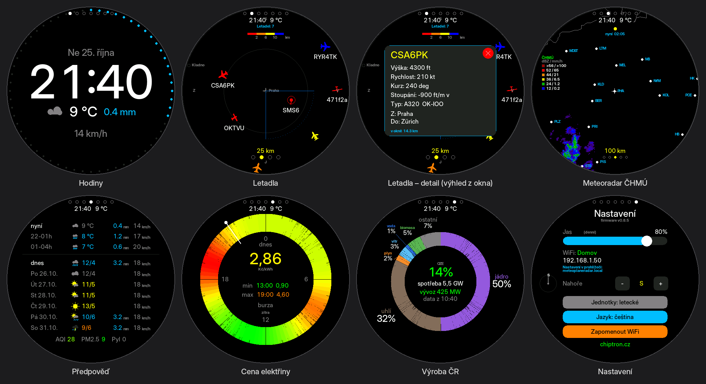
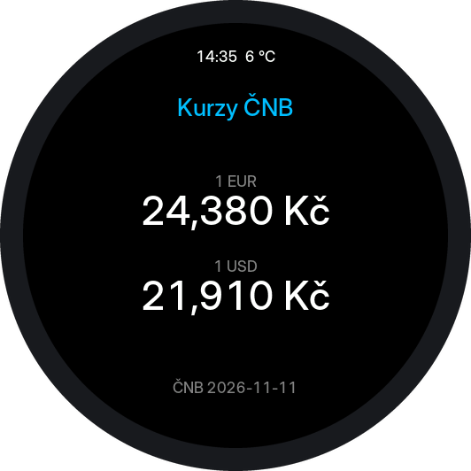
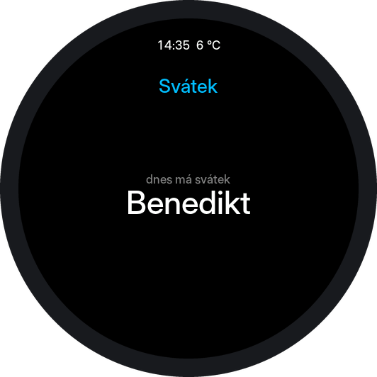
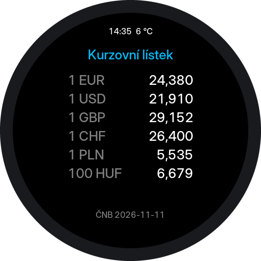
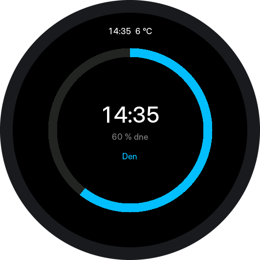
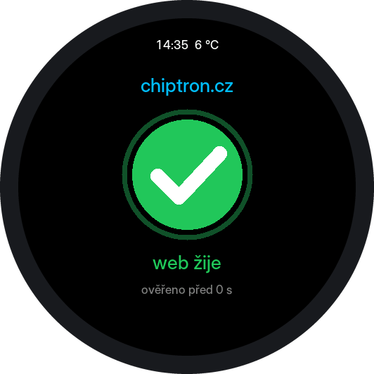

# MeteoPlaneRadar

**A clock, live aircraft radar, precipitation radar, weather forecast and
electricity prices on a round touchscreen.** Runs on a single Waveshare
ESP32-S3-Touch-LCD-2.1 or ESP32-S3-Touch-LCD-2.8C board and is configured from
a browser.

> Built by **[chiptron.cz](https://chiptron.cz)** with Claude AI.
> Czech version of this document: [README.md](README.md)

> Do you like this project? It is free and open-source but you may support me by **https://buymeacoffee.com/chiptroncz**




---

## Switch it to English

The device ships in Czech. There are two ways to change that, and both stick
across restarts.

### On the device

1. **Long-press the right half of the screen** until you reach **Nastaveni**
   (Settings) — it is the last screen in the cycle.
2. Near the bottom there are three wide buttons. Press the **middle** one,
   labelled **`Jazyk: cestina`**.
3. It immediately becomes **`Language: English`** and the whole interface
   follows.

### In the browser

1. Open `http://meteoplaneradar.local/` (the address is also printed on the
   Settings screen).
2. Top right there is a language selector — choose **English**.

The page and the device both switch immediately; there is nothing to save.

The same selector appears in the setup portal during first-time WiFi
configuration, so you can switch before anything else.

> The built-in display font is 7-bit ASCII. Czech is therefore drawn without
> diacritics; English renders exactly as written.

---

## What it is

A standalone WiFi device with a round 480×480 touchscreen. Put it on a shelf
next to your monitor and a glance tells you what is flying overhead and whether
it is about to rain.

It is not a phone and does not try to be one.

## What it does

| Screen | Shows | Source |
| --- | --- | --- |
| **Clock** | time, date, current weather, seconds ring | Open-Meteo |
| **Aircraft** | aircraft around you, tap for details and route | adsb.fi, adsb.lol |
| **Weather radar** | animated precipitation | CHMI, CHMI masked or RainViewer |
| **Forecast** | now, two 3-hour windows, today and six more days, air quality and pollen | Open-Meteo |
| **Electricity price** | spot price on a quarter-hour dial, today and tomorrow | OTE via spotovaelektrina.cz |
| **Generation** | what the grid is running on, renewable share, load, export | Energy-Charts (Fraunhofer ISE) |
| **Cards** | your own screens: values from any JSON API (e.g. CNB exchange rates) or a card with its own program | set by the card, see [cards](cards/README.md) |
| **Settings** | brightness, map orientation, units, language | — |

Any of the first seven can be switched off in the browser; Settings is always
reachable.

Both energy screens are **off after an update** — turn them on in the browser.
While a screen is off the device never asks for its data at all.

### Clock

Date, large time, current weather with temperature and rain, wind speed below.
A **seconds ring** runs around the rim — off, dots, a continuous line, or a
comet with a fading tail. Clock and seconds colours are configurable.

**Typeface** (0.8.0): the time, date, temperature and wind are drawn from real
font outlines with 16 levels of anti-aliasing — **Inter** (default),
**Poppins**, **Inter thin**, or the original pixel font. The digits are
tabular, so the time does not shift sideways as the minutes change, and the
Czech date keeps its accents.

No Home Assistant and no sensor: the weather comes from the same request the
forecast screen makes anyway.

There is **no NTP client**. The time is taken from the `Date` header of the
HTTP responses the device makes regardless.

The **time zone** rides along with the forecast: Open-Meteo returns the offset
for your own coordinates, so it costs no extra request and nothing to set. Until
the first fetch the rule compiled into `TZ_INFO` in `Config.h` applies, which is
Central European Time. If the offset from the network matches what is already in
force, the compiled-in rule stays — so a Czech device keeps real daylight-saving
dates rather than freezing at one offset. Otherwise the device switches to the
fixed offset the server reported. The current value is on the web status page.

### Aircraft

Aircraft icons are colour-coded by flight level. Since 0.8.0 the three
boundaries and the four colours can be changed on the Aircraft tab; the
defaults are:

| Altitude | Colour | Typically |
| --- | --- | --- |
| Below 2 km | Red | Approach and departure, helicopters, light aircraft |
| 2 to 6 km | Orange | Climb, descent, regional traffic |
| 6 to 10 km | Yellow | Lower cruise levels |
| 10 km and up | Blue | Long-haul cruise |

An aircraft not reporting its altitude is drawn grey, not red.

The **icon follows the airframe** (0.8.0), after the scheme of
[adsb-radar.com](https://adsb-radar.com/help/icons.html): helicopters have a
rotor disc, gliders long thin wings, an A380 is visibly bigger than a Cessna.
The kind comes from the ICAO type code adsb.fi sends (A20N, B738, EC35...), or
from the ADS-B emitter category when the type is unknown; anything else keeps
the original arrow.

**Aircraft nearby** (0.8.0, Screens tab): the Aircraft screen leaves the
automatic cycling and instead jumps in for a set time (default 15 s) whenever an
aircraft comes within a set distance (default 5 km) - with that aircraft's
detail already open - then the cycling carries on where it was. Each aircraft
is shown once per 15 minutes.

**Window view** (0.8.0, Aircraft tab): the bearing of your window, the width of
the view and how far you can see. An aircraft in the view takes priority for
the alert over a nearer one you cannot see from the window. The sector is drawn
on the radar.

Tap one for the detail panel: altitude, speed, track, climb rate, aircraft type,
registration and where it is flying from and to. It updates live while open.

**Emergency squawks** 7500 (hijack), 7600 (radio failure) and 7700 (general
emergency) can be watched for. Such an aircraft gets a double red ring and a red
banner replaces the aircraft count. There are also filters — altitude range,
only aircraft with a callsign — and a **watched callsign or ICAO address** that
is highlighted in green. Filters affect drawing only; they never hide an
emergency or a watched aircraft.

**Map orientation:** the `Nahore` / `Top` row in Settings sets which compass
bearing is at the top of the screen. Set the direction you are looking out of
the window and an aircraft seen to the left of the roof appears to the left on
the display. Eight positions, 45° apart. The weather radar deliberately does not
rotate — a precipitation map is read north-up.

### Weather radar

The device downloads the last six frames at five-minute intervals and loops
them, so you can see where the rain is heading. Each frame carries its time
("now" or "−X min" plus HH:MM), and there is an intensity legend in dBZ and
mm/h.

Ranges: 25, 50, 100, 200 km and the whole Czech Republic.

**Three sources, switchable in the browser:**

- **CHMI** (default) — sharper, but the data ends just beyond the Czech border.
  With a location abroad the screen stays blank. Shows every echo the radars
  see, at full colour.
- **CHMI masked** (0.8.0) — the same composite, but CHMI checks it against the
  2 km PseudoCAPPI: only where the rain actually reaches the ground is it drawn
  at full colour; rain evaporating on the way down and distant storm anvils
  come out paler. Better for "will it rain here?", while plain CHMI is better
  for watching storms.
- **RainViewer** — European and global coverage, also free and keyless. Coarser:
  their tiles stop at zoom 7, roughly 790 metres per pixel, so closer ranges are
  built from what is available. That is genuinely all the detail there is.

The legend switches with the source and says which one you are reading — each
radar has its own palette, so the same yellow means 40 dBZ on one scale and 35
on the other.

**Radar only when a storm is coming** (0.8.0, Screens tab): the weather radar
joins the automatic cycling only while an echo of at least a set strength
(default 20 dBZ) lies within a set distance (default 50 km). The newest CHMI
frame is checked every five minutes; two clear frames in a row drop the radar
out again. Works even with the weather radar screen switched off. CHMI data
only, so Czechia and a little beyond.

### Forecast

**Now**, then two three-hour windows written as the hours they cover
(`14-17h`), then **today** and six further days labelled by weekday and date
(`We 16.9.`). Each row has a vector weather icon derived from the WMO code,
temperature, precipitation and wind. Within a window the temperature is the
mean, precipitation the sum, wind the peak and the icon the worst of the hours
in it. Days show maximum and minimum. Every value carries its unit.

### Electricity price

The Czech spot price on a round dial. Since 1 October 2025 the market trades in
**quarter-hour blocks**, so the dial has 96 sectors rather than 24, coloured
from cheap to expensive across that day's own range. The middle shows the block
you are in; tap a sector to read any other. Below it the cheapest and the
dearest block of the day, each with its time.

Tomorrow's prices appear once the exchange publishes them, usually early
afternoon; until then that half of the screen says so instead of guessing.

The figure is the **exchange price**, not your bill. Your own margin in CZK/MWh
and VAT go in on the Energy tab, and the screen states which of the two numbers
it is showing so nobody compares it with an invoice and concludes the device is
broken.

This screen is **Czech only** — the source serves no other market — and with a
location outside the Czech Republic it switches itself off rather than showing
figures that do not apply to you.

### Generation

A donut of what the grid is running on right now: nuclear, coal, gas, solar,
wind, hydro, biomass and the rest, each labelled with its name and share. In the
middle the renewable share, and below it load, together with import or export.

Any European country can be chosen on the Energy tab, or `eu` for the whole
union. Unknown generation types from the source are counted as "other" and
logged rather than silently dropped, and the screen cross-checks the total
against load plus export — if those disagree by more than a little, it says so
instead of drawing a confident pie of wrong numbers.

### Air quality and pollen

Three lines at the bottom of the forecast screen: the **European AQI**, **PM2.5**
in µg/m³, and **pollen** — the strongest of alder, birch and grass, with the
species named. Pollen is a European product and simply does not appear
elsewhere.

---

## Hardware

**Waveshare ESP32-S3-Touch-LCD-2.1** or **ESP32-S3-Touch-LCD-2.8C** — ESP32-S3R8
(8 MB PSRAM, 16 MB flash), round 480×480 IPS display with an ST7701 controller,
TCA9554 I/O expander. Touch is a CST820 on the 2.1 and a GT911 on the 2.8C.
One board and a USB-C cable; nothing to solder or wire.

The two boards are pin-for-pin identical and **one binary runs on both** — at
boot the firmware asks the touch controller who it is and picks the panel init
sequence and the timing from the answer. Which board it settled on is in the
serial log at startup and in the status table in the browser. If it ever gets it
wrong on your board (a dead touch controller, most likely), `BOARD_FORCE` in
`Config.h` pins it down.

## First run

1. Flash the firmware (below) and power the board.
2. Join the open WiFi network **`MeteoPlaneRadar`** — a QR code is shown on the
   display.
3. Open `http://192.168.4.1/`, pick your home network and save.

The access point stays up until you enter a network. Without a connection the
device has nothing to fetch and nothing to show.

Afterwards the settings live at **`http://meteoplaneradar.local/`**, or at the
IP address printed on the Settings screen.

## Configuration in a browser

The web interface runs permanently and is split into seven tabs so it works on a
phone: **Control** (switch screens and range remotely, device status),
**Location** (manual or by searching for a town name), **Screens** (which to
show, auto-cycling, radar source), **Appearance** (day and night brightness,
sun-driven night mode, seconds ring, colours), **Aircraft** (filters, squawks,
watched callsign, map orientation, units), **Energy** (price margin and VAT,
country for the generation screen) and **System** (password, firmware update,
settings backup, restart, factory reset, data sources).

Most settings are **saved the moment you change them**. The Save button is only
needed for the location, the set of screens and the radar source, because those
restart the device.

The status page reports IP, signal strength, uptime, free memory, the reason for
the last restart and the outcome of the last fetch from each source — diagnostics
without a serial cable.

### Password

The password is optional and **there is none by default**, which means firmware
update, settings import and factory reset are open to anyone who can reach the
device. Set one in the System tab: leave *current password* empty the first
time and fill in *new password* only. A single space in the new password field
removes the protection. The username on `/update` is `admin`.

The password is **stored in the clear**, because the update page uses HTTP Basic
and the library has to be given the real password. It protects against the
household, not against someone who can read the flash.

**A forgotten password can only be cleared by holding the BOOT button at
startup**, which is a factory reset and also erases WiFi.

## Controls

| Gesture | Action |
| --- | --- |
| **Swipe** left/right | Change the range (aircraft, weather radar) |
| **Short tap** | Select an aircraft; on the clock, toggle day/night |
| **Long press, left half** | Previous screen |
| **Long press, right half** | Next screen |
| **Hold BOOT at startup (~3 s)** | Factory reset |

Screens and range can also be changed from the browser, without touching the
glass.

---

## Flashing

**Over USB** (first flash and rescue): download `*.merged.bin` from Releases,
connect the board to the connector marked **USB**, and flash it at
[esp32flasher.chiptron.cz](https://esp32flasher.chiptron.cz) in Chrome or Edge.

**Over WiFi:** download `*.ino.bin` (the one **without** `merged`) and upload it
at `http://meteoplaneradar.local/update`. The display goes dark during the
write — the RGB panel streams its framebuffer from PSRAM and flash writes cut
its data off — and lights back up when finished. A failed update leaves the
previous version running.

Versions older than 0.4 must be flashed over USB once; their flash layout has no
room for an over-the-air update.

**Coming from 0.5.x?** The stored WiFi is not carried over — it used to be held
by WiFiManager, which is no longer used. The device will bring up its own
network once and you enter your WiFi again. Location, brightness and map
orientation are kept.

## Several WiFi networks

Since 0.8.0 the device remembers up to **three networks**. They are entered on
the Control tab and can be typed in while out of range. At boot the strongest
one in range is tried first; when the link drops, after a minute the other
saved networks are tried.

## Home Assistant

> **⚠ Not tested with a real Home Assistant.** The format follows the
> documentation of the RESTful integration, but nobody has pointed one at the
> device yet. Please report anything that does not fit.

Home Assistant **pulls** the data from

```
http://meteoplaneradar.local/api/ha
```

with its built-in **RESTful** integration - no MQTT, broker or add-on needed.
Switch it on in the web UI on the **Home Assistant** tab, copy the ready-made
block from there into `configuration.yaml` and restart Home Assistant. Sensors
such as `MPR Teplota`, `MPR Bourka` and `MPR Nejblizsi letadlo` appear.

The answer carries the current weather, today's min/max, sunrise and sunset,
the storm watch (active, strongest echo, distance), the nearest aircraft
(callsign, type, kind, distance, altitude, bearing, in the window or not), the
aircraft count, the electricity price and the renewable share. It is
read-only and needs no password. While it is on, the storm watch (one CHMI
frame per 5 minutes) and a small aircraft poll (every 30 s) run too.

## Cards

Cards are screens you add yourself. Every card is a screen of its
own: it takes its turn with the others at the same interval, so four built-in
screens and two cards make six screens. There can be up to 8 cards. The row
of dots at the top, which has one dot per screen and per card, is therefore
hidden by default; it can be switched on in the device's web UI. They come
in three parts:

| | |
| --- | --- |
| **[JSON cards](#json-cards)** | a card without a program: a small file says where to fetch an answer and which values to show; the firmware does the layout |
| **[Script cards](#script-cards-a-program-in-a-card)** | a card with **its own program** in Berry that draws the whole display itself |
| **[Card store](#card-store)** | the device installs cards from this repository by itself and checks their signature first |

<p align="center">
  
  
</p>
<p align="center">
  
  
  
</p>
<p align="center"><sub>Previews of the sample cards: two JSON cards above, three script cards below. The screens were rendered by the firmware's own code running on a PC with real answers from the sources (rates of 11 November 2026, name day of 12 November 2026); they are not photos of the device.</sub></p>

### JSON cards

A JSON card shows values you add yourself: exchange rates, a temperature from
your home automation, anything with a JSON API that can be read without
logging in. It is a small file that says where to fetch the answer, which
values to pick out of it and what to call them. This kind of card is data,
not code: the firmware does the layout on the round display.

The sample card with the Czech National Bank exchange rates
([cards/kurzy-cnb.json](cards/kurzy-cnb.json)):

```json
{
  "v": 1,
  "id": "kurzy-cnb",
  "title": "Kurzy ČNB",
  "url": "https://api.cnb.cz/cnbapi/exrates/daily?lang=EN",
  "refresh_min": 60,
  "rows": [
    { "label": "1 EUR", "path": "rates[currencyCode=EUR].rate", "decimals": 3, "unit": "Kč" },
    { "label": "1 USD", "path": "rates[currencyCode=USD].rate", "decimals": 3, "unit": "Kč" }
  ],
  "note": { "label": "ČNB", "path": "rates[0].validFor" }
}
```

The second sample, [cards/svatek.json](cards/svatek.json), shows a text value:
whose name day it is today in the Czech calendar, from nameday.abalin.net.

| | |
| --- | --- |
| **Values** | 1 to 4 values per card and an optional small line at the bottom |
| **Path to a value** | `data.amount`, `list[0].price` or `rates[currencyCode=EUR].rate` — an array element picked by its content, not its position |
| **Value format** | label, unit, number of decimals, multiplier; a decimal comma when the device is in Czech |

### Script cards: a program in a card

A JSON card can only show a few values in a fixed layout. A card that also
has a `script` member carries a **program** in
[Berry](https://berry-lang.github.io) and draws the whole display itself:
tables, rings, its own layout. The device still fetches the address given in
the card; the program decides what to draw from the answer.

The program of the sample card Den, "Day"
([cards/src/den.be](cards/src/den.be), shortened): a ring showing how much of
the day has passed.

```berry
def draw()
  var s = cfg.hms()   # seconds since midnight
  g.ring(240, 240, 150, 168, 0, 360, g.DKGRAY)
  if s == nil
    g.label('waiting for the clock', 232, 2, g.YELLOW)
    return
  end
  g.ring(240, 240, 150, 168, 0, s * 360 / 86400, g.CYAN)
  g.label(format('%02d:%02d', s / 3600, (s % 3600) / 60), 190, 5, g.WHITE)
end
```

| | |
| --- | --- |
| **Samples** | [kurzy-listek.json](cards/kurzy-listek.json) — the CNB exchange-rate table, six currencies with aligned numbers; [den.json](cards/den.json) — how much of the day has passed, needs no internet; [web-chiptron.json](cards/web-chiptron.json) — is chiptron.cz up? A green tick, or a red cross after three failed checks in a row; it fetches a small JSON answer from the site's WordPress every 5 minutes (not an ICMP ping). The programs are in [cards/src](cards/src) |
| **Switching on** | scripts are **off** by default. They are allowed in the device's web UI, Screens tab, **Allow scripts in cards**. While they are off, a script card shows only its title and a message that the script is not running |
| **What a program may do** | draw (`g`), read the answer from its own card's address (`net`), read the card's parameters and the time (`cfg`). It cannot reach files, settings or the network: it fetches and sends nothing by itself |
| **Safeguards** | one run may take 500 ms and hold 96 kB of memory; three failures in a row switch that card's script off; if the device restarts in the middle of a script, the script is switched off at the next boot (safe mode) |
| **Size** | a program of at most 6000 bytes, a whole card of at most 8192 bytes |
| **Writing one** | `tools/make_script_card.py` packs a `.be` program and a `.json` description into one card; the simulator in [tools/sim](tools/sim) runs a card on a PC, without the board |

It is still a program. Take script cards only from a source you would trust
with a firmware update. The script API and how to write a card:
[cards/README.md](cards/README.md#karty-se-skriptem) (in Czech).

### Card store

Cards from this repository can be added without downloading a file: in the
device's web UI, **Store** tab, **Load the offer**, then **Add** next to a
card. The offer is the list in [cards/index.json](cards/index.json). The
device checks the signature of the list (ECDSA P-256) against a key in the
firmware and compares each card with the SHA-256 the list gives for it; a
changed, unsigned or older list is refused. The signature only says that the
holder of the key published the list, not that anyone vetted the cards.
Details and how to run your own store:
[cards/README.md](cards/README.md#obchod-s-kartami) (in Czech).

### Common to all cards

| | |
| --- | --- |
| **Management** | upload and removal in the device's web UI, Screens tab, or adding from the store; behind the admin password if one is set |
| **Storage** | LittleFS in the `spiffs` partition, which the project did not use until now; cards survive a restart and a firmware update |
| **Fetching** | every 5 to 1440 minutes (60 by default); after a failure the last values stay on screen with a note and the device retries in 2 minutes |
| **Default** | the Cards screen is off, and while it is off it fetches nothing; scripts are allowed separately |
| **Screen dots** | the row of dots at the top is hidden by default; **Show the screen dots at the top** on the Screens tab switches it on, and the change shows at once |
| **API** | `/api/cards` (GET, POST), `/api/cards/delete` (POST), `/api/store` (GET), `/api/store/install` (POST), `/api/scripts` (POST); `cards` was added to `/api/config`, `/api/status` and `/api/ha` |
| **Cost** | cards make the binary 56 kB larger, the store another 12 kB, scripts about another 100 kB; no library to install was added (the Berry interpreter is bundled) |
| **Limitation** | a card cannot send HTTP headers yet (such as `Authorization`), so only what can be read without logging in works |

The full format description is in [cards/README.md](cards/README.md) (in Czech).

## For developers

Arduino IDE with **ESP32 core 3.x** (built with 3.3.10). Libraries: **GFX
Library for Arduino** (1.5.3 or newer, built with 1.6.9), **PNGdec** (1.1.4 or
newer, built with 1.1.7), **ArduinoJson v7**; QRCode is bundled. `WebServer`, `DNSServer`,
`ESPmDNS`, `Update` and `Preferences` come with the core. WiFiManager was
dropped in 0.6.0, ElegantOTA in 0.6.2.

Board settings: ESP32S3 Dev Module, **PSRAM: OPI** (without this the display
stays black), Flash 16 MB QIO, **Partition Scheme: Custom** (`partitions.csv`,
two app slots for OTA), USB CDC On Boot: Enabled. Or
`arduino-cli compile --profile default MeteoPlaneRadar`.

```
MeteoPlaneRadar.ino   screen manager, touch, main loop
Config.h              all tunable constants
Settings.*            NVS settings + JSON for the web UI
Lang.*                Czech and English strings
Layout.*              screen bands and collision checking
WebConfig.* WebPage.h web server, API, captive portal, OTA
Net.*                 shared HTTPS fetching
Forecast.*            Open-Meteo: forecast, sun times, air quality
Energy.*              spot electricity price and generation mix
TimeZone.*            time zone from the location
RainViewer.*          tile radar
StormWatch.*          storm watch from the CHMI frame (0.8.0)
PlaneWatch.*          aircraft-nearby watch and window view (0.8.0)
PlaneIcon.*           aircraft icons by type (0.8.0)
AAFont.* ClockFonts.h anti-aliased clock typefaces (0.8.0)
Screen*.{h,cpp}       individual screens
tools/make_fonts.py   generates ClockFonts.h from TTF/OTF
```

**Why nothing overlaps:** each screen reserves its chrome before the map is
drawn. Anything positioned by data — city labels, aircraft callsigns — must then
claim its rectangle and is dropped if the space is taken. The `LY_*` constants in
`Layout.h` keep the same elements on the same lines across screens.

Serial log at 115200 Bd over the connector marked **USB**. The same information
is on the web status page.

---

## Data sources and attribution

Personal, non-commercial use only unless you arrange otherwise. **Several of
these require credit** — see [LICENSE.txt](LICENSE.txt) for the details.

| Data | Source | Note |
| --- | --- | --- |
| Aircraft, registration, type | [adsb.fi](https://adsb.fi) | Free, no key, personal use |
| Route | [adsb.lol](https://adsb.lol) | Free, no key; route data by [vradarserver/standing-data](https://github.com/vradarserver/standing-data) |
| Precipitation (CZ) | [CHMI](https://opendata.chmi.cz) | Attribution required |
| Precipitation (world) | [RainViewer](https://www.rainviewer.com) | Attribution required |
| Weather, forecast, sun, air quality, geocoding, time zone | [Open-Meteo](https://open-meteo.com) | CC BY 4.0, attribution required, free tier non-commercial |
| Electricity price | OTE via [spotovaelektrina.cz](https://spotovaelektrina.cz) | Free, no key; no attribution asked, and no warranty of any kind given |
| Electricity generation | [Energy-Charts.info](https://energy-charts.info), Fraunhofer ISE | CC BY 4.0, **attribution required**; 2 requests/min per IP per endpoint |
| Location by IP | [ip-api.com](http://ip-api.com) | Free tier non-commercial |
| Map | Natural Earth (public domain), [GeoNames](https://www.geonames.org) (CC BY 4.0) | Attribution required |

The same list, with working links, is in the device itself under the **System**
tab. That panel is not decoration: GeoNames, CHMI, RainViewer, Open-Meteo and
Energy-Charts all **require** their source to be credited, and RainViewer asks
for a link back. A 480×480 panel has no room for a legible credit line, so the
web page is where this project discharges that obligation. In a fork, replace
it rather than delete it.

Two further notes:

- Only the Energy-Charts `/public_power` endpoint is used. Their `/price`
  endpoint is **not** uniformly CC BY 4.0 — for most bidding zones it is marked
  private and internal use only, with commercial use prohibited unless licensed
  from the original providers. This project deliberately gets its price
  elsewhere.
- spotovaelektrina.cz marks its hourly endpoints deprecated ("for new projects,
  do not use") because they return averages of four quarter-hour blocks. The
  firmware uses `get-prices-json-qh`.

**Aircraft icons:** the assignment of aircraft types to icon shapes follows
the scheme of [ADS-B Radar](https://adsb-radar.com/help/icons.html). The
shapes are drawn by the firmware; no icon files are used.

## Licence

**MIT** — see [LICENSE.txt](LICENSE.txt). It covers the source code and the
binaries built from it. Since 0.6.2 the project has no copyleft dependency.

The clock typefaces (**Inter**, **Poppins**) are under the SIL Open Font
License 1.1, which allows embedding them in firmware.

**MIT does not cover the data.** **GeoNames**, **CHMI**, **RainViewer**,
**Open-Meteo** and **Energy-Charts.info** all require visible attribution, and
the free Open-Meteo and adsb.fi APIs are for non-commercial use only. The OTE
prices arrive through spotovaelektrina.cz, whose terms promise nothing about
reliability, availability or correctness — read the number as information, not
as a basis for trading. LICENSE.txt has the details — **read it in full before
any commercial deployment.**

Beyond what the licence requires: if you build on this, I would be glad if you
kept the **chiptron.cz** credit on the settings screen. A request, not a
condition.

## Contributors

- **[Pájeníčko.cz](https://pajenicko.cz)**
  - **Support for the Waveshare ESP32-S3-Touch-LCD-2.8C.** The board is
    identified at boot from its touch controller, so one binary runs on both
    the 2.1 and the 2.8C and nobody has to pick which file to flash.
  - **The weather radar legend can be hidden** — a toggle in the web settings.

## Built on

- [petus/MeteoPlaneRadar](https://github.com/petus/MeteoPlaneRadar) — this project
- [ok1cdj/MeteoPlaneRadar](https://github.com/ok1cdj/MeteoPlaneRadar) — Ondra OK1CDJ's fork; the source of the RainViewer, forecast screen, screen toggles and auto-cycling ideas. His version also has an APRS screen and PlatformIO support
- [CooLajz/waveshare-hodiny](https://github.com/CooLajz/waveshare-hodiny) — a Home Assistant dashboard on the same board; inspiration for the clock, seconds ring, night mode and web configuration
- [MatixYo/ESP32-Plane-Radar](https://github.com/MatixYo/ESP32-Plane-Radar) — the original aircraft radar and the adsb.fi source
- [Selbyl/ESP32-S30Touch-LCD-2.1_Plane-Radar](https://github.com/Selbyl/ESP32-S30Touch-LCD-2.1_Plane-Radar) — the port to Waveshare 480×480
- [mylms/ESP-MeteoRadar](https://github.com/mylms/ESP-MeteoRadar) — the CHMI precipitation radar

Change history: [CHANGELOG.md](CHANGELOG.md). Version: `MeteoPlaneRadar/Version.h`.
