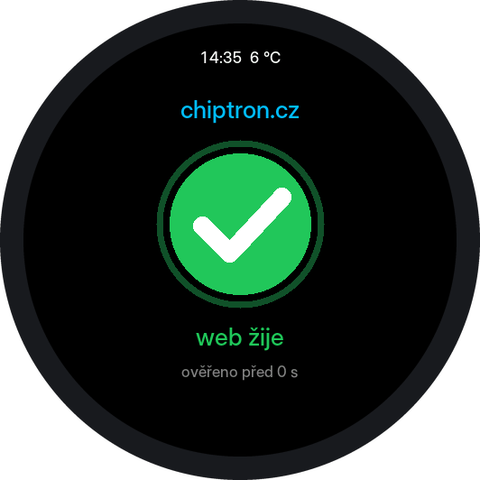

# Karty

Karta je malý soubor JSON, který přidá na displej další obrazovku s několika
hodnotami staženými z internetu nebo z domácí sítě: kurzy měn, teplotu z Home
Assistantu, cenu čehokoli, co má veřejné JSON rozhraní.

Karty jsou dvojího druhu:

- **Karta JSON** je popis, ne program. Říká, odkud se má stáhnout odpověď,
  které hodnoty z ní vybrat a jak je pojmenovat. Rozvržení na kulatém displeji
  si firmware dělá sám. Popisuje ji první část tohoto dokumentu.
- **[Karta se skriptem](#karty-se-skriptem)** v sobě navíc nese program
  v jazyce Berry a celý displej si kreslí sama.

Karty jde nahrát ze souboru, nebo je zařízení přidá samo
z [obchodu](#obchod-s-kartami).

## Jak kartu přidat

1. Na webu zařízení, záložka **Obrazovky**, zapněte obrazovku **Karty** a uložte.
2. Ve stejné záložce v části **Karty** zvolte **Přidat kartu ze souboru**
   a vyberte soubor `.json`.
3. Je-li nastavené heslo správce, vyplňte ho předtím na záložce **Systém**.

Karet může být nejvýš 8. **Každá karta je samostatná obrazovka:** střídá se
s ostatními ve stejném intervalu a přechází se na ni stejně jako na kteroukoli
jinou. Se čtyřmi vestavěnými obrazovkami a dvěma kartami se jich tedy střídá
šest. Karta se stejným `id` nahradí tu původní.

Řada teček nahoře, která má jednu tečku za každou obrazovku i kartu, je ve
výchozím stavu skrytá, protože s několika kartami je dlouhá a málo říká.
Zapíná se na záložce **Obrazovky** volbou **Zobrazovat tečky obrazovek
nahoře**.

## Ukázka: kurzy ČNB

[`kurzy-cnb.json`](kurzy-cnb.json) — kurz eura a dolaru podle kurzovního lístku
České národní banky.

```json
{
  "v": 1,
  "id": "kurzy-cnb",
  "title": "Kurzy ČNB",
  "url": "https://api.cnb.cz/cnbapi/exrates/daily?lang=EN",
  "refresh_min": 60,
  "rows": [
    { "label": "1 EUR", "path": "rates[currencyCode=EUR].rate", "decimals": 3, "unit": "Kč" },
    { "label": "1 USD", "path": "rates[currencyCode=USD].rate", "decimals": 3, "unit": "Kč" }
  ],
  "note": { "label": "ČNB", "path": "rates[0].validFor" }
}
```

## Ukázka: svátek

[`svatek.json`](svatek.json) — kdo má dnes svátek, podle
[nameday.abalin.net](https://nameday.abalin.net). Hodnota nemusí být číslo:
tady je to text a cesta k němu je obyčejná cesta objektem. Parametr `timezone`
v adrese říká zdroji, podle kterého času má počítat „dnes“.

```json
{
  "v": 1,
  "id": "svatek",
  "title": "Svátek",
  "url": "https://nameday.abalin.net/api/V2/today?timezone=Europe/Prague",
  "refresh_min": 60,
  "rows": [
    { "label": "dnes má svátek", "path": "data.cz" }
  ]
}
```

O některých svátcích zdroj ke jménu přidává i název svátku („Adam a Eva, Štědrý
den“) a takový text se na displeji ořízne — viz délka hodnoty níže.

## Formát

| Pole | Povinné | Význam |
| --- | --- | --- |
| `v` | ne | verze formátu, zatím vždy `1` |
| `id` | ano | 1–23 znaků z `a-z`, `0-9`, `-`; je to i jméno souboru v zařízení |
| `title` | ano | nadpis karty, nejvýš 27 bajtů |
| `url` | ano | adresa začínající `http://` nebo `https://`, která vrací JSON; nejvýš 199 znaků |
| `refresh_min` | ne | jak často stahovat, v minutách; 5 až 1440, výchozí 60 |
| `rows` | ano | 1 až 4 řádky, viz níže |
| `note` | ne | malý řádek dole: `path` a volitelně `label` |

Řádek (`rows[]`):

| Pole | Povinné | Význam |
| --- | --- | --- |
| `path` | ano | kde v odpovědi hodnota je, viz níže; nejvýš 71 znaků |
| `label` | ne | popisek nad hodnotou, nejvýš 19 bajtů |
| `unit` | ne | jednotka za hodnotou, nejvýš 9 bajtů |
| `decimals` | ne | počet desetinných míst, 0 až 6. Bez něj: celá čísla beze změny, ostatní na 2 místa |
| `scale` | ne | čím hodnotu vynásobit před zobrazením (např. `0.001` z Wh na kWh) |

Délky jsou v bajtech UTF-8: písmeno s háčkem nebo čárkou zabere dva.
Text, který se do pole nevejde, zařízení odmítne a napíše, které pole to bylo.

### Cesta k hodnotě

| Zápis | Význam |
| --- | --- |
| `data.amount` | prvek objektu |
| `list[0].price` | prvek pole podle pořadí (od nuly) |
| `rates[currencyCode=EUR].rate` | první prvek pole, jehož `currencyCode` je `EUR` |

Třetí tvar použijte všude, kde pořadí v poli není zaručené. Kurzovní lístek je
takový případ: `rates[7]` by po přidání jedné měny ukázalo jinou.

Hodnota může být číslo, text nebo `true`/`false`. Text, který je ve skutečnosti
číslo (`"97123.50"`), se jako číslo zformátuje, pokud řádek uvádí `decimals`
nebo `scale`. V češtině se desetinná tečka čísel zobrazí jako čárka.

Zobrazená hodnota má nejvýš 23 bajtů (malý řádek dole 27); delší text se
ořízne na hranici znaku.

## Co je dobré vědět

- **Karta nedělá nic jiného, než že stahuje adresu a ukazuje hodnoty.** Přesto
  přidávejte jen karty, kterým rozumíte: adresu, na kterou se bude zařízení
  pravidelně ptát, určuje autor karty.
- Odpověď smí mít nejvýš tolik, kolik firmware dovolí pro textové odpovědi
  (`NET_MAX_TEXT` v `Config.h`). Do paměti se z ní ukládají jen hodnoty, které
  karta čte.
- HTTP hlavičky (např. `Authorization` pro Home Assistant) karta zatím poslat
  neumí. Funguje tedy jen to, co jde přečíst bez přihlášení.
- Když se stažení nepovede, zůstanou na displeji poslední hodnoty s poznámkou
  o starších datech a zařízení to za dvě minuty zkusí znovu. Stav posledního
  stažení je na webu na záložce Ovládání v tabulce stavu.
- S pixelovým písmem se diakritika v textech karty zobrazí bez háčků a čárek
  („Kč“ jako „Kc“). Vyhlazená písma ji umí; znak, který písmo nemá (např. €),
  se vynechá — pište raději `EUR`.
- Dokud je obrazovka Karty vypnutá, zařízení kvůli kartám nic nestahuje.

## Karty se skriptem

Karta JSON umí ukázat nejvýš čtyři hodnoty v pevném rozvržení. Karta, která
má navíc položku `script`, dostane celý displej: zařízení dál samo stahuje
adresu uvedenou v kartě a malý program v jazyce
[Berry](https://berry-lang.github.io) rozhodne, co z odpovědi nakreslí.

Tři ukázky:

- [`kurzy-listek.json`](kurzy-listek.json) — kurzovní lístek ČNB, šest měn
  pod sebou se zarovnanými čísly (zdroj: [`src/kurzy-listek.be`](src/kurzy-listek.be)).
- [`den.json`](den.json) — kolik dne už uběhlo, prstenec a čas; nepotřebuje
  internet (zdroj: [`src/den.be`](src/den.be)).
- [`web-chiptron.json`](web-chiptron.json) — žije web chiptron.cz? (zdroj:
  [`src/web-chiptron.be`](src/web-chiptron.be)), popis níže.

### Ukázka: hlídání webu

Karta `web-chiptron` hlídá, jestli web odpovídá. Zařízení každých 5 minut
stáhne adresu `https://chiptron.cz/wp-json/?_fields=name`: malou odpověď
(asi 20 bajtů), kterou WordPress sestaví až po průchodu webovým serverem,
PHP i databází. Když přijde v pořádku, je kruh zelený s fajfkou a pod ním
„web žije“ a čas poslední kontroly.

Když kontrola selže, zařízení to zkusí znovu za 2 minuty. Po prvním
a druhém nezdaru je kruh oranžový s vykřičníkem („neodpovídá, ověřuji“), po
třetím nezdaru za sebou, tedy asi 9 minut po poslední dobré odpovědi,
červený s křížkem („web nežije“). Jeden zakolísaný požadavek tak poplach
nevyvolá.

<p align="center"></p>

Není to ping v síťovém smyslu (ICMP): karta umí jen stáhnout adresu přes
HTTP(S) a odpověď musí být JSON. Pro jiný web na WordPressu stačí v kartě
změnit `id`, `title` a doménu v `url`; jiný web potřebuje adresu, která vrací
JSON a stavový kód 200. Hlídejte jen weby, kde vám to nevadí: každé zařízení
s kartou pošle 288 požadavků denně.

```berry
def draw()
  var s = cfg.hms()
  g.ring(240, 240, 150, 168, 0, 360, g.DKGRAY)
  if s == nil
    g.label('čekám na čas', 232, 2, g.YELLOW)
    return
  end
  g.ring(240, 240, 150, 168, 0, s * 360 / 86400, g.CYAN)
  g.label(format('%02d:%02d', s / 3600, (s % 3600) / 60), 190, 5, g.WHITE)
end
```

### Zapnutí

Skripty jsou ve výchozím stavu **vypnuté**. Zapínají se na webu zařízení,
záložka **Obrazovky**, volba **Povolit skripty v kartách** (s heslem správce,
je-li nastavené). Dokud jsou vypnuté, karta se skriptem ukáže jen nadpis
a hlášení, že skript neběží.

### Co skript smí

Skript má k dispozici jen tohle:

| | |
| --- | --- |
| `g` | kreslení na displej |
| `net` | poslední odpověď z adresy uvedené v kartě |
| `cfg` | parametry karty, jazyk rozhraní, čas |
| `string`, `math`, `json` | moduly jazyka Berry |

Nemá přístup k souborům, k nastavení zařízení ani k ostatním kartám
a nemůže sám nic stáhnout ani **odeslat**: jediná adresa ve hře je ta zapsaná
v kartě a stahuje ji zařízení, ne skript.

Přesto je to program, ne popis. Platí pro něj tyto pojistky:

- Jedno vykreslení smí trvat nejvýš 500 ms a interpret smí držet nejvýš 96 kB
  paměti. Po překročení zařízení skript ukončí způsobem, který skript nemůže
  zachytit.
- Chyba ve skriptu displej nezastaví: karta ukáže nadpis a hlášení, co se
  stalo. Po třech selháních za sebou se skript té karty vypne.
- **Bezpečný režim:** než se spustí jakýkoli kód skriptu, zařízení si
  poznamená, které kartě patří, do paměti, která přežije restart. Pokud se
  zařízení restartuje uprostřed skriptu (pád, hlídací časovač), skript té
  karty se při dalším startu vypne, místo aby zařízení shodil znovu.
- Zastavený skript jde znovu zapnout na webu u dané karty, nebo novým
  nahráním karty.

Zbývající riziko je interpret sám: chybu v něm by mohl zneužít zlomyslný
skript. Karty se skriptem berte jen ze zdroje, kterému byste svěřili
i aktualizaci firmwaru.

### Pole karty navíc

| Pole | Význam |
| --- | --- |
| `script` | program v jazyce Berry, nejvýš 6000 bajtů; musí definovat funkci `draw()` |
| `url` | u karty se skriptem nepovinné (karta může kreslit jen z času) |
| `rows` | u karty se skriptem nepovinné |
| `keep` | nejvýš 6 cest (stejný zápis jako `path`), které z odpovědi skriptu zůstanou; bez nich dostane odpověď celou. To, co zůstane, se musí vejít do 8192 bajtů |
| `params` | objekt s libovolnými hodnotami pro skript, čte se přes `cfg.get()` |
| `redraw_s` | po kolika sekundách se má karta sama překreslit (0 až 3600; 0 = jen když přijdou nová data) |

Soubor karty smí mít nejvýš 8192 bajtů.

### Rozhraní pro skript

Displej má 480 × 480 bodů a je kulatý: v rozích nic není vidět. Souřadnice
`y` je vršek textu. Barvy jsou čísla RGB565; hotové jsou `g.BLACK`, `g.WHITE`,
`g.GRAY`, `g.DKGRAY`, `g.RED`, `g.GREEN`, `g.BLUE`, `g.YELLOW`, `g.CYAN`,
`g.ORANGE`. Velikost textu je 1 až 5.

| Volání | Význam |
| --- | --- |
| `g.label(text, y, velikost, barva)` | text vystředěný na displeji; je-li na dané výšce moc široký, zmenší se |
| `g.text(text, x, y, velikost, barva)` | text od bodu `x`, `y` |
| `g.text_w(text, velikost)` | šířka textu v bodech |
| `g.line(x0, y0, x1, y1, barva)` | úsečka |
| `g.rect(x, y, š, v, barva)`, `g.fill_rect(…)` | obdélník, vyplněný obdélník |
| `g.circle(x, y, r, barva)`, `g.fill_circle(…)` | kružnice, kruh |
| `g.ring(x, y, r_vnitřní, r_vnější, od, do, barva)` | výseč mezikruží; úhly ve stupních po směru hodin od dvanáctky |
| `g.fill(barva)` | celý displej jednou barvou |
| `g.rgb(r, g, b)` | barva ze složek 0 až 255 |
| `g.half(y)` | polovina šířky displeje ve výšce `y` |
| `g.W`, `g.H` | 480, 480 |
| `net.data()` | poslední odpověď jako mapy a seznamy, nebo `nil`, dokud žádná není |
| `net.ok()` | poslední stažení se povedlo |
| `net.age()` | sekundy od poslední povedené odpovědi, nebo `nil` |
| `cfg.get(klíč, výchozí)` | hodnota z `params` karty |
| `cfg.lang()` | `'cs'` nebo `'en'` |
| `cfg.title()` | nadpis karty |
| `cfg.hms()` | sekundy od místní půlnoci, nebo `nil`, dokud zařízení nezná čas |

Stavový řádek nahoře (čas, teplota) a tečky obrazovek, jsou-li zapnuté, kreslí
zařízení samo až po skriptu, takže je skript nepřekreslí.

### Jak kartu se skriptem napsat

Soubor karty je jeden dokument JSON a ten neumí zapsat program na víc řádků.
Karta se proto píše jako dva soubory ve složce [`src`](src): `<id>.json` se
vším kromě programu a s položkou `script_file`, a `<id>.be` s programem.
Dohromady je složí

```
python3 tools/make_script_card.py
```

Kartu jde vyzkoušet na počítači bez desky. Simulátor v `tools/sim` spustí
skutečný kód firmwaru včetně interpretu a uloží obrázky:

```
curl -o /tmp/odpoved.json "https://api.cnb.cz/cnbapi/exrates/daily?lang=EN"
ARDUINOJSON=<složka s ArduinoJson.h> tools/sim/run.sh cards/kurzy-listek.json /tmp/odpoved.json /tmp/nahled
```

## Obchod s kartami

Karty z této složky jde přidat i bez stahování souboru: na webu zařízení,
záložka **Obchod**, tlačítko **Načíst nabídku** a u vybrané karty **Přidat**.

Jak to funguje:

1. Zařízení si samo stáhne seznam [`index.json`](index.json) a jeho podpis
   [`index.json.sig`](index.json.sig). Adresu má ve firmwaru
   (`STORE_INDEX_URL` v `Config.h`).
2. Podpis ověří proti veřejnému klíči ve firmwaru (`StoreKey.h`). Seznam,
   jehož podpis nesouhlasí, nepřijme a nic z něj nenabídne.
3. Při přidání stáhne soubor karty a porovná ho s otiskem SHA-256, který pro
   něj uvádí seznam. Teprve pak projde karta stejnou kontrolou jako karta
   nahraná ručně.

K čemu podpis je: firmware při HTTPS neověřuje certifikáty, takže bez podpisu
by nabídku mohl podvrhnout kdokoli na cestě. K čemu není: neříká, že kartu
někdo prověřil — jen že seznam zveřejnil držitel klíče. U karty se skriptem
na tom záleží víc než u karty JSON: nabídka u každé takové karty uvádí, že
nese program.

Seznam má pořadové číslo. Zařízení si pamatuje nejvyšší, které přijalo,
a starší seznam odmítne, takže stažená karta nejde vrátit zpět podstrčením
staré, správně podepsané nabídky.

Po změně nabídky může GitHub ještě pár minut vracet starší verzi některého
souboru. Zařízení pak nabídku nebo kartu odmítne; stačí to za chvíli zkusit
znovu.

### Správa nabídky

Seznam a podpis vyrábí `tools/make_index.py`:

```
python3 tools/make_index.py            # po přidání nebo změně karty
python3 tools/make_index.py --check    # jen ověří, že seznam a podpis sedí
```

Nástroj projde `cards/*.json`, zkontroluje je, spočítá otisky, zvýší pořadové
číslo a seznam podepíše soukromým klíčem. Ten se hledá v `--key`, v proměnné
`MPR_STORE_KEY` a v `~/.config/meteoplaneradar/store-signing-key.pem`; do
repozitáře nepatří. Popisky karet v nabídce jsou v
[`store-meta.json`](store-meta.json).

Vlastní obchod: vytvořte si pár klíčů
(`openssl ecparam -name prime256v1 -genkey -noout -out klic.pem`), veřejný
klíč (`openssl ec -in klic.pem -pubout`) dejte do `StoreKey.h`, v `Config.h`
změňte `STORE_INDEX_URL` na adresu svého seznamu a firmware přeložte.

## Přidání vlastní karty do repozitáře

Pošlete pull request se souborem `cards/<id>.json` a popiskem v
`cards/store-meta.json`. Seznam obchodu podepisuje správce repozitáře. Karta by měla používat
zdroj, který je veřejný, bez klíče a jehož podmínky takové použití dovolují.
